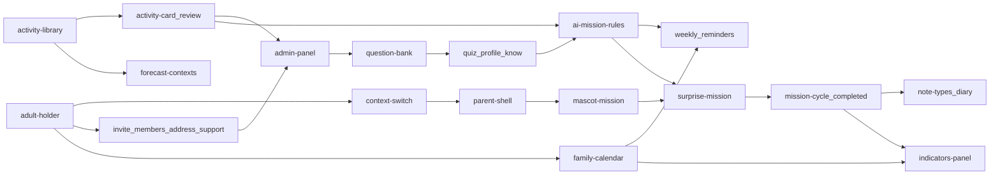

# Implementation Waves

Source: `docs/harness/features/*` and `especs/design-docs/tdd-feature-*.md`. Do not invent features. GoF patterns: implement **all** patterns listed in each feature harness / TDD Technical Solution.

## Status (2026-10-20)

Waves **0–9** are implemented (Red/Green Vitest + Pittore FE where the wave has FE). Handoffs live under `especs/tdd/wave{N}/`. `npx tsc --noEmit` and `npm run build` pass. Full Vitest last recorded: **327 passed**.

| Wave | Backend | Frontend | Notes |
|------|---------|----------|-------|
| 0 | done | done | Platform shell, SQLite, health |
| 1–4 | done | done | Before this resume |
| 5 | done | done | Quiz, GPS, what-we-know, calendar |
| 6 | done | n/a (`FE: —`) | `POST /api/families/{id}/missions/pick` published ids only |
| 7 | done | done | Forecast week, calendar PATCH, surprise |
| 8 | done | done | Cycle + completed history; migration `080100_family_mission_title.sql` (model also `ADD COLUMN` if Wave 0 runner skipped it) |
| 9 | done | done | Diary five kinds, no photos; panel indicators zeros-on-empty |

Still open (not blockers for the wave exit criteria unless noted):

- Babylon Gate was **not** run (explicit user override this conversation).
- Mock session is process-wide via `globalThis` **outside Vitest**; Vitest keeps a module store so `resetModules` isolation still works. Switching panel Admin then opening a family screen can still 403 until the mock role is Parent again.
- No `GET /api/family-missions/{id}` — a refresh mid-Doing re-offers Start and the PATCH can 422.
- Canva: Safari / Firefox / iOS device passes remain manual.
- Blocked table below is unchanged (auth, MinIO keys, payments, native, live weather, quiz mode column).

Ops: `nixpacks.toml` pins Node 22 + native build deps for `better-sqlite3`. `.dockerignore` excludes `graphify-out`, `node_modules`, `.next`, `.env`. Local compose `Dockerfile` still starts `npm run dev`.

## Rules of execution

- **Lane** = code feature folder, not an F-ID. One lane may carry several F-IDs. The same folder may reappear in a later wave.
- **Owned paths** are split by layer (`DB:`, `BE:`, `FE:`; `—` means nothing in that layer). A lane writes only there.
- **Layer order inside a lane is bottom-up: DB → Backend → Frontend.**
- Scultore owns DB + Backend. Pittore owns Frontend. Handoff: `especs/tdd/wave{N}/handoff-to-pittore.md` then `handoff-to-scultore.md`.
- Each TDD Implementation Plan is Red → Green (Vitest on API/models/services). Frontend: no unit tests; Pittore browser verification.
- **Migration range** (`WWLL00–WWLL99`) is exclusive to the lane. Wave 0 applies the full SQLite schema from `my_docs/schema.sqlite.sql`; later waves only additive migrations inside their range.
- Shared touchpoints (`app` route registry, global providers) are merged by Scultore (BE) or Pittore (FE) append-only after lanes are green. Two lanes never write the same file in the same wave.
- Blocked parts are not implemented. `⛔` rows in Blocked items are skipped.
- Wave N+1 starts only after wave N exit criteria are met (per-wave default).
- Parent and Child screens render ONLY inside the family mobile emulator (HTML iPhone 15 Pro Max chrome). They never appear as full-bleed desktop pages. The Admin/Operator panel is a normal web layout and must not host Parent/Child family screens.
- Wave 2 session FE (context-switch) must live under `app/(family)` and only be visible inside that chrome. If chrome is Wave 3 parent-shell, do not ship Parent/Child views on the panel or on an unframed desktop route; mount them in the family surface that the chrome wraps.

## Wave 0 — Platform prerequisites (not a feature)

Single lane, no TDD.

| Layer | What | Owned paths |
|-------|------|-------------|
| DB | Apply portable star schema (SQLite prototype) | `db/migrations/000000_schema.sql` (copy of study schema; same names as Postgres 15 file) |
| BE | Next.js TypeScript app; Active Record connection singleton; `queryRaw`; mock session store (no auth tables) | `internal/db/**`, `app/api/health/**` |
| FE | App shell only: panel layout vs family layout **without** phone chrome or screens | `app/layout.tsx`, `app/(panel)/layout.tsx`, `app/(family)/layout.tsx` |
| Ops | Dev compose + Dockerfile; Nixpacks-ready single repo | `Dockerfile`, `docker-compose.yml` |

**Exit criteria:** SQLite boots with FKs on; health route 200; both layouts render empty; typed TypeScript; no ORM; no Flowbite; no `.env` written by agents.

## Wave overview

| Wave | Features | Parallel agents (lanes) | Blocked by |
|------|----------|-------------------------|------------|
| 0 | platform | 1 | — |
| 1 | adult-holder, activity-library | 2 | Wave 0 |
| 2 | context-switch; adult-invite + members-without-app + family-address + families-subscriptions; activity-card + review-flow | 3 | Wave 1 |
| 3 | parent-shell, admin-panel, forecast-contexts | 3 | Wave 2 |
| 4 | mascot-mission, question-bank | 2 | Wave 3 |
| 5 | family-quiz + quiz-modes + family-profile + what-we-know; family-calendar | 2 | Wave 4 |
| 6 | ai-mission-rules | 1 | Wave 5 |
| 7 | weekly-suggestion + reminders; surprise-mission | 2 | Wave 6 |
| 8 | mission-cycle + completed-missions | 1 | Wave 7 |
| 9 | note-types + family-diary; indicators-panel | 2 | Wave 8 |

## Wave 1 — Titular and catalog seeds

| Lane | Features (TDD) | DB → Backend → Frontend owned paths | Migration range | Depends on (earlier waves) | Shared touchpoints |
|------|----------------|-------------------------------------|-----------------|----------------------------|--------------------|
| identity | adult-holder ([TDD](tdd-feature-adult-holder.md)) | DB: — · BE: `models/app_user`, `models/family`, `models/family_profile`, `models/family_diary`, `app/api/app-users/**`, `app/api/families/**` · FE: — | 010100–010199 | Wave 0 | route registry |
| catalog | activity-library ([TDD](tdd-feature-activity-library.md)) | DB: — · BE: `models/mission_category`, `models/mission`, `app/api/mission-categories/**`, `app/api/missions/**` · FE: — | 010200–010299 | Wave 0 | route registry |

**Exit criteria:** titular create + family husk green; twelve categories seeded; Parent cannot POST catalog; Vitest green; no conflicting migrations.

## Wave 2 — Session, family document, catalog fiche

| Lane | Features (TDD) | DB → Backend → Frontend owned paths | Migration range | Depends on (earlier waves) | Shared touchpoints |
|------|----------------|-------------------------------------|-----------------|----------------------------|--------------------|
| session | context-switch ([TDD](tdd-feature-context-switch.md)) | DB: — · BE: `app/api/session/**`, `policies/role` · FE: `app/(family)/context-switch/**` | 020100–020199 | Wave 1 identity | family layout provider |
| family | adult-invite ([TDD](tdd-feature-adult-invite.md)), members-without-app ([TDD](tdd-feature-members-without-app.md)), family-address ([TDD](tdd-feature-family-address.md)), families-subscriptions ([TDD](tdd-feature-families-subscriptions.md)) | DB: — · BE: `models/family_invite`, `models/plan`, `app/api/families/**` (members, address, invites), `app/api/panel/families/**` · FE: — | 020200–020299 | Wave 1 identity | `models/family` (this lane only) |
| catalog-fiche | activity-card ([TDD](tdd-feature-activity-card.md)), review-flow ([TDD](tdd-feature-review-flow.md)) | DB: — · BE: `models/mission` (extend), `app/api/missions/[id]/**` · FE: — | 020300–020399 | Wave 1 catalog | `models/mission` (this lane only) |

**Exit criteria:** mock session Parent→Child; invites/members/address/plan support APIs; fiche + review_status; family APIs omit unpublished; Vitest green.

## Wave 3 — Surfaces and forecast tags

| Lane | Features (TDD) | DB → Backend → Frontend owned paths | Migration range | Depends on (earlier waves) | Shared touchpoints |
|------|----------------|-------------------------------------|-----------------|----------------------------|--------------------|
| family-shell | parent-shell ([TDD](tdd-feature-parent-shell.md)) | DB: — · BE: — · FE: `app/(family)/chrome/**` | 030100–030199 | Wave 2 session | family layout |
| panel | admin-panel ([TDD](tdd-feature-admin-panel.md)) | DB: — · BE: `app/api/panel/**` guards · FE: `app/(panel)/**` | 030200–030299 | Wave 2 family + catalog-fiche | panel layout |
| forecast | forecast-contexts ([TDD](tdd-feature-forecast-contexts.md)) | DB: — · BE: `models/forecast_context`, `models/mission_forecast_context`, `app/api/forecast-contexts/**` · FE: — | 030300–030399 | Wave 1 catalog | route registry |

**Exit criteria:** family UI only inside iPhone 15 Pro Max chrome; panel has no chrome; Parent 403 on panel; four context seeds; Pittore verified chrome vs panel.

## Wave 4 — Mascot delivery and question bank

| Lane | Features (TDD) | DB → Backend → Frontend owned paths | Migration range | Depends on (earlier waves) | Shared touchpoints |
|------|----------------|-------------------------------------|-----------------|----------------------------|--------------------|
| mascot | mascot-mission ([TDD](tdd-feature-mascot-mission.md)) | DB: — · BE: — · FE: `app/(family)/missions/mascot/**` | 040100–040199 | Wave 3 family-shell | family chrome |
| questions | question-bank ([TDD](tdd-feature-question-bank.md)) | DB: — · BE: `models/family_quiz`, `app/api/panel/questions/**` · FE: `app/(panel)/questions/**` | 040200–040299 | Wave 3 panel | panel router |

**Exit criteria:** mascot typewriter + reduced-motion strategy; question kinds; Parent cannot CRUD bank; Pittore browser on mascot.

## Wave 5 — GPS / quiz and calendar hub

| Lane | Features (TDD) | DB → Backend → Frontend owned paths | Migration range | Depends on (earlier waves) | Shared touchpoints |
|------|----------------|-------------------------------------|-----------------|----------------------------|--------------------|
| gps | family-quiz ([TDD](tdd-feature-family-quiz.md)), quiz-modes ([TDD](tdd-feature-quiz-modes.md)), family-profile ([TDD](tdd-feature-family-profile.md)), what-we-know ([TDD](tdd-feature-what-we-know.md)) | DB: — · BE: `models/family_profile` (extend), `app/api/families/[id]/quiz/**`, `app/api/families/[id]/profile/**` · FE: `app/(family)/quiz/**`, `app/(family)/profile/**` | 050100–050199 | Wave 4 questions | `models/family_profile` (this lane only) |
| calendar | family-calendar ([TDD](tdd-feature-family-calendar.md)) | DB: — · BE: `models/family_calendar`, `app/api/families/[id]/calendar/**` · FE: `app/(family)/calendar/**` | 050200–050299 | Wave 1 identity | route registry |

**Exit criteria:** quiz envelope answers; solo/table mode; GPS read; what-we-know edit/delete; unique family+day; unpublished missions rejected on calendar.

## Wave 6 — Pick rules

| Lane | Features (TDD) | DB → Backend → Frontend owned paths | Migration range | Depends on (earlier waves) | Shared touchpoints |
|------|----------------|-------------------------------------|-----------------|----------------------------|--------------------|
| pick | ai-mission-rules ([TDD](tdd-feature-ai-mission-rules.md)) | DB: — · BE: `services/mission_pick`, `app/api/families/[id]/missions/pick/**` · FE: — | 060100–060199 | Wave 5 gps + Wave 2 catalog-fiche | route registry |

**Exit criteria:** pick returns only published catalog ids; free-text invention discarded; non-repeatable history skipped.

## Wave 7 — Forecast actions and surprise

| Lane | Features (TDD) | DB → Backend → Frontend owned paths | Migration range | Depends on (earlier waves) | Shared touchpoints |
|------|----------------|-------------------------------------|-----------------|----------------------------|--------------------|
| calendar-ops | weekly-suggestion ([TDD](tdd-feature-weekly-suggestion.md)), reminders ([TDD](tdd-feature-reminders.md)) | DB: — · BE: `app/api/families/[id]/forecast/**`, calendar PATCH · FE: `app/(family)/forecast/**` | 070100–070199 | Wave 6 pick + Wave 5 calendar + gps | `models/family_calendar` (this lane only) |
| surprise | surprise-mission ([TDD](tdd-feature-surprise-mission.md)) | DB: — · BE: `models/family_mission`, `app/api/families/[id]/missions/surprise/**` · FE: `app/(family)/missions/surprise/**` | 070200–070299 | Wave 6 pick + Wave 4 mascot | mascot view |

**Exit criteria:** finite weekly list drops on a day; done/moved; rhythm proposal after four repeats; surprise empty does not invent copy; Factory opens Accepted `family_mission`.

## Wave 8 — Mission cycle and history

| Lane | Features (TDD) | DB → Backend → Frontend owned paths | Migration range | Depends on (earlier waves) | Shared touchpoints |
|------|----------------|-------------------------------------|-----------------|----------------------------|--------------------|
| mission-play | mission-cycle ([TDD](tdd-feature-mission-cycle.md)), completed-missions ([TDD](tdd-feature-completed-missions.md)) | DB: — · BE: `models/family_mission` (extend), `app/api/family-missions/**` · FE: `app/(family)/missions/cycle/**`, `app/(family)/missions/completed/**` | 080100–080199 | Wave 7 surprise | `models/family_mission` (this lane only) |

**Exit criteria:** Accepted→Doing→Completed + closing JSON; repeatable second row; `missions_completed` increments; history list.

## Wave 9 — Diary and indicators

| Lane | Features (TDD) | DB → Backend → Frontend owned paths | Migration range | Depends on (earlier waves) | Shared touchpoints |
|------|----------------|-------------------------------------|-----------------|----------------------------|--------------------|
| diary | note-types ([TDD](tdd-feature-note-types.md)), family-diary ([TDD](tdd-feature-family-diary.md)) | DB: — · BE: `models/family_diary` (extend), `app/api/families/[id]/diary/**` · FE: `app/(family)/diary/**` | 090100–090199 | Wave 8 mission-play | `models/family_diary` (this lane only) |
| indicators | indicators-panel ([TDD](tdd-feature-indicators-panel.md)) | DB: — · BE: `app/api/panel/indicators/**` · FE: `app/(panel)/indicators/**` | 090200–090299 | Wave 8 + Wave 5 calendar | panel router |

**Exit criteria:** five note kinds; no photos; indicators match SQL counts; zeros on empty; Pittore panel + diary screens.

## Blocked items

| Item | Status | Rule |
|------|--------|------|
| Supabase Auth | ⛔ partly blocked | Mock session only; `auth_user_id` pointer unused |
| MinIO/S3 credentials | ⛔ partly blocked | `img_path` stores a path string; Adapter exists, no live upload until user supplies keys |
| Payments | ⛔ | Free plan seed only |
| Native mobile | ⛔ | Phone chrome only |
| Live weather API | ⛔ | `previous_weather` text; forecast_context staff tags |
| Member relation/age/interests columns | ⛔ partly blocked | Not in `family_members` envelope yet (`schema.md` limitation) |
| Quiz mode DB column | ⛔ partly blocked | Request flag only |

## Dependency graph

## Feature index

| F-ID | Feature | Wave | Lane | TDD |
|------|---------|------|------|-----|
| F-01 | adult-holder | 1 | identity | [tdd-feature-adult-holder.md](tdd-feature-adult-holder.md) |
| F-02 | activity-library | 1 | catalog | [tdd-feature-activity-library.md](tdd-feature-activity-library.md) |
| F-03 | activity-card | 2 | catalog-fiche | [tdd-feature-activity-card.md](tdd-feature-activity-card.md) |
| F-04 | review-flow | 2 | catalog-fiche | [tdd-feature-review-flow.md](tdd-feature-review-flow.md) |
| F-05 | context-switch | 2 | session | [tdd-feature-context-switch.md](tdd-feature-context-switch.md) |
| F-06 | adult-invite | 2 | family | [tdd-feature-adult-invite.md](tdd-feature-adult-invite.md) |
| F-07 | members-without-app | 2 | family | [tdd-feature-members-without-app.md](tdd-feature-members-without-app.md) |
| F-08 | family-address | 2 | family | [tdd-feature-family-address.md](tdd-feature-family-address.md) |
| F-09 | families-subscriptions | 2 | family | [tdd-feature-families-subscriptions.md](tdd-feature-families-subscriptions.md) |
| F-10 | parent-shell | 3 | family-shell | [tdd-feature-parent-shell.md](tdd-feature-parent-shell.md) |
| F-11 | admin-panel | 3 | panel | [tdd-feature-admin-panel.md](tdd-feature-admin-panel.md) |
| F-12 | forecast-contexts | 3 | forecast | [tdd-feature-forecast-contexts.md](tdd-feature-forecast-contexts.md) |
| F-13 | mascot-mission | 4 | mascot | [tdd-feature-mascot-mission.md](tdd-feature-mascot-mission.md) |
| F-14 | question-bank | 4 | questions | [tdd-feature-question-bank.md](tdd-feature-question-bank.md) |
| F-15 | family-quiz | 5 | gps | [tdd-feature-family-quiz.md](tdd-feature-family-quiz.md) |
| F-16 | quiz-modes | 5 | gps | [tdd-feature-quiz-modes.md](tdd-feature-quiz-modes.md) |
| F-17 | family-profile | 5 | gps | [tdd-feature-family-profile.md](tdd-feature-family-profile.md) |
| F-18 | what-we-know | 5 | gps | [tdd-feature-what-we-know.md](tdd-feature-what-we-know.md) |
| F-19 | family-calendar | 5 | calendar | [tdd-feature-family-calendar.md](tdd-feature-family-calendar.md) |
| F-20 | ai-mission-rules | 6 | pick | [tdd-feature-ai-mission-rules.md](tdd-feature-ai-mission-rules.md) |
| F-21 | weekly-suggestion | 7 | calendar-ops | [tdd-feature-weekly-suggestion.md](tdd-feature-weekly-suggestion.md) |
| F-22 | reminders | 7 | calendar-ops | [tdd-feature-reminders.md](tdd-feature-reminders.md) |
| F-23 | surprise-mission | 7 | surprise | [tdd-feature-surprise-mission.md](tdd-feature-surprise-mission.md) |
| F-24 | mission-cycle | 8 | mission-play | [tdd-feature-mission-cycle.md](tdd-feature-mission-cycle.md) |
| F-25 | completed-missions | 8 | mission-play | [tdd-feature-completed-missions.md](tdd-feature-completed-missions.md) |
| F-26 | note-types | 9 | diary | [tdd-feature-note-types.md](tdd-feature-note-types.md) |
| F-27 | family-diary | 9 | diary | [tdd-feature-family-diary.md](tdd-feature-family-diary.md) |
| F-28 | indicators-panel | 9 | indicators | [tdd-feature-indicators-panel.md](tdd-feature-indicators-panel.md) |
