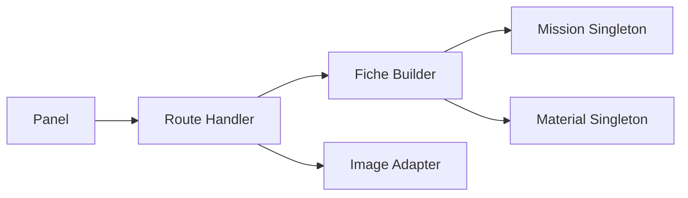

# TDD: Activity card

## 1. Header & Metadata

| Field | Value |
|-------|-------|
| Tech lead | Bruno |
| Team | Great Kids |
| Epic | prototype high-fidelity |
| Status | Draft |
| Date | 2026-10-19 |
| Size | Small |

## 2. Technical Solution

Staff fiche for one catalog mission. Reads and patches the Wave 0 `mission` row plus `mission_material`. `values` is an envelope, never a bare array (INV-004). Image storage is a later Adapter; this phase persists `img_path` as text. Family APIs still only see published missions (INV-001, INV-005). No ORM.

**Patterns (all required):** Builder assembles optional fiche fields (description, img_path, duration, ages, setting, materials, values). Adapter maps a later object store to `img_path`; until credentials exist the Adapter is unused in CI and the handler stores the path string only.

**Security note:** unpublished fiches are panel-only. Family GET of a draft id returns empty/error and never invents a mission.

**Wave 0 owns DDL** for `mission` (img_path, type, format, age_min/max, duration_minutes, setting, values) and `mission_material`. This feature does not add tables.

**Schema:** `mission.type` Activity|Quality-time|Conversation|Workout|Faith-Time|Money-Time. `mission.format` Quick-Win|Signature|Mission|Say-What. `setting` Indoor|Outdoor|Either. `values` `{ id, values: [string] }`. CHECK age_min ≤ age_max. `mission_material` unique (mission_id, material_id), status Can-use|Not-use|Need-update. Column is `img_path`, not a feat image alias.

| Method | Path | Auth | Request | Response |
|--------|------|------|---------|----------|
| GET | /api/missions/{id} | Staff | — | `{ id, mission: { title, description, img_path, type, format, duration_minutes, age_min, age_max, setting, values, materials, review_status, status } }` |
| PATCH | /api/missions/{id} | Staff | same fields | `{ id, mission: { … } }` |

Errors: age_min > age_max reject; invalid type/format/setting enum reject.

## 3. Context Pillars

**How do you describe the feature?**
"Título, descrição, tipo (Quick Win, Signature, Missão ou pergunta Say What?), tempo, faixa etária, dentro ou fora de casa, materiais, valores que trabalha e status."

**What problem does it objectively solve?**
A category list is not enough to pick or review an activity; staff need the full fiche.

**What is the expected solution? What trade-offs does it involve?**
One `mission` row: title, description, `img_path`, type, format (Quick-Win, Signature, Mission, Say-What), duration, age_min/max, setting, values JSON envelope, materials via `mission_material`. Trade-off: values as JSON envelope not a values table.

**What example or context do we have of the problem and the solution?**
`great-kids-funcionalidades.md` Ficha da atividade. Schema `mission`.

## 4. Context

The library lists missions under categories. Staff still need title, copy, format, time, ages, indoor/outdoor, materials, values, and status on one fiche before review or family use.

Values stay on the mission envelope so pick rules can read them without a values table. Materials link curated rows; Need-update is a later review concern.

## 5. Problem Statement & Motivation

A title-only list cannot support review or pick: missing ages, setting, and values make suggestions generic or unsafe. Invalid enums or inverted ages corrupt the catalog. Cost of delay: review-flow and family pick have no fiche to publish.

## 6. Scope

**In scope (V1):** GET/PATCH fiche fields including img_path; values envelope; materials link; enum and age checks.

**Out of scope:** live object-store upload; family PATCH; values as a table; inventing missions.

**Future:** Adapter upload to object storage; richer values taxonomy; material preview.

## 7. Risks

| Risk | Impact | Probability | Mitigation |
|------|--------|-------------|------------|
| Bare array stored in values | H | M | Envelope check; reject |
| Invalid format/type persisted | H | M | Enum CHECK + handler reject |
| Family reads draft fiche | H | L | Policy; unpublished hidden |

## 8. Implementation Plan

Each phase is Red (failing Vitest) then Green (minimal code), then refactor.

| Phase | Task | TDD cycle | Owner | Estimate |
|-------|------|-----------|-------|----------|
| 1 – Read fiche | GET /api/missions/{id} | Red: img_path and values envelope fail → Green: read handler | Scultore | 0.5d |
| 2 – Patch fiche | PATCH fields + Builder | Red: age invert and bad enum fail → Green: Builder + checks | Scultore | 0.5d |
| 3 – Adapter stub | Image Adapter contract | Red: maps path only → Green: unused-in-CI Adapter | Scultore | 0.25d |

## 9. Testing Strategy

| Type | Scope | Approach |
|------|-------|----------|
| Unit | Builder, enum/age rules | Vitest: optional fields, rejects |
| Integration | GET/PATCH fiche | Vitest: img_path name, `{ id, values: [] }`, invalid enum does not persist |

Critical: fiche fields match schema; values envelope; invalid enum does not persist.
