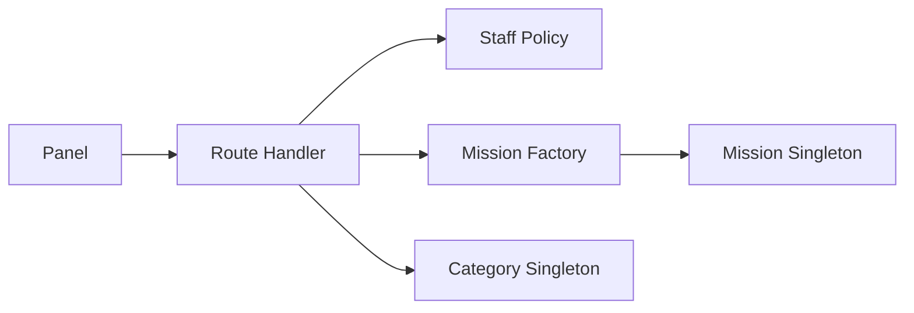

# TDD: Activity library by category

## 1. Header & Metadata

| Field | Value |
|-------|-------|
| Tech lead | Bruno |
| Team | Great Kids |
| Epic | prototype high-fidelity |
| Status | Draft |
| Date | 2026-10-19 |
| Size | Small |

## 2. Technical Solution

Staff catalog of activities under twelve seeded categories. Family never writes the library. Unpublished rows stay panel-only (INV-001, INV-005). Persistence is Active Record + queryRaw (no ORM). Hub lists use JSON envelopes `{ id, <key>: [] }`.

**Patterns (all required):** Factory creates a mission with required `category_id`, `review_status=draft`, and `values` `{ id, values: [] }`. Singleton Active Record accessors for `mission` and `mission_category`.

**Security note:** unpublished missions are panel-only. Family APIs never list draft or in_review. Staff-only writes.

**Wave 0 owns DDL** for `mission_category` and `mission` (including later card and review columns). This feature seeds twelve slugs and does not emit a second migration.

**Schema (Wave 0):** `mission_category` (id, unique slug, name, timestamps). `mission` (id, status active|inactive, title, description, required category_id FK, review_status, deleted, values envelope, timestamps). Seed slugs: watch, read, make, cook, play, go, listen, talk, grow, faith, serve, celebrate.

| Method | Path | Auth | Request | Response |
|--------|------|------|---------|----------|
| GET | /api/mission-categories | Staff | — | `{ id, categories: [{ id, slug, name }] }` |
| POST | /api/mission-categories | Staff | `{ slug, name }` | `{ id, category: { id, slug, name } }` |
| GET | /api/missions | Staff | optional category_id | `{ id, missions: [{ id, title, category_id, review_status }] }` |
| POST | /api/missions | Staff | `{ category_id, title }` | `{ id, mission: { id, category_id, review_status } }` |

Errors: unknown `category_id` rejects the write. Parent POST catalog → 403.

## 3. Context Pillars

**How do you describe the feature?**
"Cadastro e manutenção das atividades, separadas por categorias. Categorias sugeridas a partir do material: Watch, Read, Make, Cook, Play, Go, Listen, Talk, Grow, Faith, Serve e Celebrate."

**What problem does it objectively solve?**
Staff need a single catalog of things a family might do, grouped the way the Idea Book speaks (Watch, Read, Make…).

**What is the expected solution? What trade-offs does it involve?**
Portal CRUD on `mission` + `mission_category` (seeded slugs). Trade-off: twelve fixed categories vs free tags; family app never edits the library.

**What example or context do we have of the problem and the solution?**
`great-kids-funcionalidades.md` portal row Biblioteca. Categories from Idea Book / material.

## 4. Context

Great Kids is a high-fidelity prototype: one Next.js app serving an Admin/Operator panel and a Parent family app in phone chrome. The Idea Book groups activities as Watch, Read, Make, Cook, Play, Go, Listen, Talk, Grow, Faith, Serve, Celebrate.

Staff own the catalog. Parents consume published rows only. This TDD is the catalog write surface; fiche fields, review, and family pick are later features.

## 5. Problem Statement & Motivation

Without a single category catalog, staff copy activities into chat or spreadsheets; families see inconsistent names. Without a required `category_id`, missions cannot be browsed the way the Idea Book speaks. If Parents could POST catalog rows, unvetted copy would reach the family app (INV-001). Cost of delay: later pick, card, and review have no library to bind to.

## 6. Scope

**In scope (V1):** twelve seeded categories; staff GET/POST categories and missions; mission requires `category_id`; Parent catalog create is 403.

**Out of scope:** family editing the library; free tags; live weather; image upload pipeline; family pick.

**Future:** extra categories after seed; category reorder; localized names.

## 7. Risks

| Risk | Impact | Probability | Mitigation |
|------|--------|-------------|------------|
| Staff create under a missing category | H | M | Reject unknown category_id; FK restrict |
| Parent reaches POST /api/missions | H | L | Staff Policy; 403 |
| Seed slug drift vs Idea Book | M | L | Fixed seed ids and slugs in Wave 0 |

## 8. Implementation Plan

Each phase is Red (failing Vitest) then Green (minimal code), then refactor.

| Phase | Task | TDD cycle | Owner | Estimate |
|-------|------|-----------|-------|----------|
| 1 – Categories | Seed + GET/POST categories | Red: twelve seeds and unique slug fail → Green: Category Singleton + handler | Scultore | 0.5d |
| 2 – Missions | Factory POST mission | Red: missing category_id and Parent 403 fail → Green: Factory + Policy | Scultore | 0.5d |
| 3 – Staff list | GET /api/missions | Red: envelope and category filter fail → Green: list handler | Scultore | 0.5d |

## 9. Testing Strategy

| Type | Scope | Approach |
|------|-------|----------|
| Unit | Factory, Singleton, Policy | Vitest: create rules, unknown category, Parent deny |
| Integration | GET/POST categories and missions | Vitest: envelope shape, seed count, FK reject |

Critical: twelve seeded categories; mission requires category_id; Parent cannot POST catalog create. No family list of unpublished rows.
