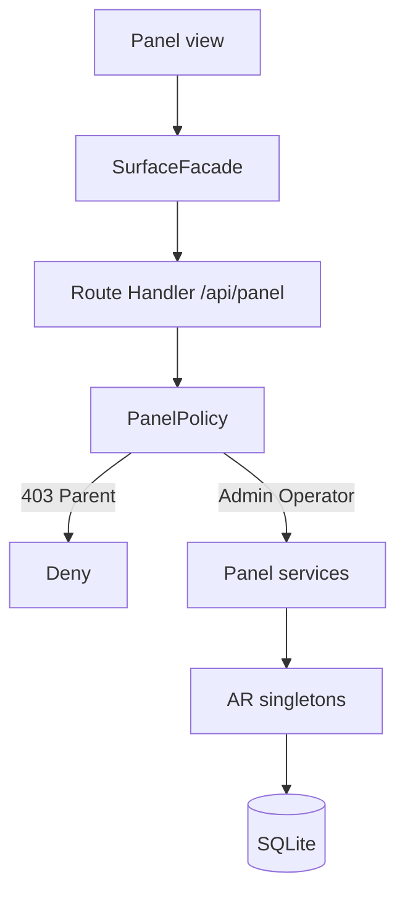

# TDD — Admin / Operator web panel

## Header & Metadata

| Field | Value |
|-------|-------|
| Tech lead | Bruno |
| Team | Great Kids |
| Epic | prototype high-fidelity |
| Status | Draft |
| Date | 2026-10-19 |
| Size | Small |
| Harness | docs/harness/features/feature-admin-panel.md |

## Technical Solution

MVC: Route Handler is the controller. Same API process serves panel and family UI. Facade chooses PanelSurface (web layout, no phone chrome) vs FamilyAppSurface. Policy gates `/api/panel/*` to Admin and Operator; Parent gets 403. Catalog, review, families/plans, questions, contexts, indicators are panel concerns; unpublished missions stay hidden from family APIs (INV-005). Unidirectional: Panel View → Route Handler → Policy → Service → Active Record singleton → SQLite.

**Policy:** PanelPolicy — Admin/Operator allow; Parent/Child 403; family reads only `review_status=published`. **Facade:** panel vs app — chrome, nav, mock role (Admin/Operator vs Parent).

Data flow: (1) Mock Admin/Operator opens panel. (2) Facade selects panel surface (no phone chrome). (3) GET `/api/panel/*`. (4) Policy 403 for Parent. (5) Services read/write catalog and support data. (6) Family surface still cannot list draft/in_review missions.

| Method | Path | Request | Response |
|--------|------|---------|----------|
| GET | /api/panel/families | — | `200 {"id":"<list>","families":[...]}` (Operator/Admin) |
| GET | /api/panel/session | — | `200 {"role":"Admin"}` or `{"role":"Operator"}` |
| GET | /api/panel/* | — | Parent → `403 {"error":"forbidden"}` |

Unpublished mission written in panel → family list still omits it. Same process serves both surfaces.

**Schema (existing):** panel reads `family`, `family_invite`, `plan`, `mission` (review_status draft\|in_review\|published), `family_quiz`, `forecast_context`. No new tables. No auth tables.

**Migration:** Wave 0 applies the full SQLite schema. This feature uses existing tables.

## Context Pillars

### Descrição
"um portal web para a equipe da plataforma (configuração e gestão)"

"o backend um api que comunica com dois fronts, um sendo o painel web que o admin e o operador usam"

### Problema
Platform staff need to configure catalog, review content, and support families without using the phone shell.

### Solução e trade-offs
Web panel (Admin, Operator) on the same Next app and API as the family UI. Trade-off: one deployable; CSS/layout must not leak the phone chrome into the panel. Flowbite is reference only.

### Exemplo / contexto
`great-kids-funcionalidades.md` §1 Portal. `prototype.md` two fronts.

## Context

Staff configure catalog, review copy, and support families. The commissioner uses the phone shell. One deployable and one API keep rules (especially INV-005) from forking. Flowbite is visual reference only, never a dependency.

Depends on catalog, review, and families/subscriptions conceptually; this TDD locks the panel surface and Policy. Stakeholders: Admin, Operator, Bruno, Scultore (panel routes), Pittore (panel layout).

## Problem Statement & Motivation

If staff work inside the phone chrome, configuration is undemonstrable and the two-front brief fails. If Parent can GET `/api/panel/*`, unpublished missions and household PII leak. If panel writes a draft mission that family APIs then return, INV-005 is broken.

## Scope

**In Scope (V1):** Panel surface without phone chrome; GET `/api/panel/*` Policy; 403 Parent; Admin/Operator open catalog/support; same API process; unpublished stays family-hidden.

**Out of Scope:** Separate panel deployable; Flowbite dependency; real SSO; Parent panel “view as”; deleting production data.

**Future:** Granular Operator vs Admin matrix; audit trail; SSO.

## Risks

| Risk | Impact | Prob. | Mitigation |
|------|--------|-------|------------|
| Parent 200 on panel API | H | M | PanelPolicy on every /api/panel/* |
| Phone chrome on panel | M | M | Facade: panel surface undecorated |
| Draft mission in family app | H | M | INV-005 on family reads |

## Implementation Plan

| Phase | Task | TDD cycle | Owner | Estimate |
|-------|------|-----------|-------|----------|
| 1 | PanelPolicy | Red: Parent 403; Operator 200 → Green: Policy | Bruno | 0.5d |
| 2 | SurfaceFacade panel vs app | Red: panel has no chrome contract → Green: Facade | Bruno | 0.5d |
| 3 | GET /api/panel/* handlers | Red: integration catalog/families + 403 → Green: Route Handlers | Bruno | 0.5d |

## Testing Strategy

| Type | Scope | Approach |
|------|-------|----------|
| Unit (Vitest) | PanelPolicy, INV-005 | Parent deny; unpublished hidden from family |
| Integration (Vitest) | /api/panel/* | Admin/Operator 200; Parent 403; same process |
| Frontend | Pittore browser | Panel has no phone chrome; catalog opens for staff |

**Critical (aceite):** panel has no phone chrome; Admin/Operator can open catalog; Parent cannot; same API process serves panel and family UI.

## Security Considerations

Mock session: Admin/Operator on panel; Parent 403. Roles Admin/Operator/Parent/Child. No child photos; real name allowed on family records staff may see — do not log PII. No `.env` writes; no auth tables; no passwords. Unpublished content is panel-only. Facade must not reuse Parent mock on panel routes.
