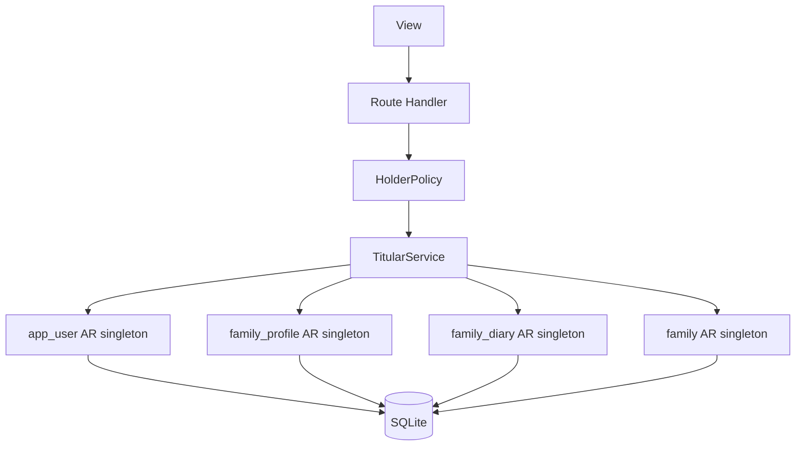

# TDD — Adult titular

## Header & Metadata

| Field | Value |
|-------|-------|
| Tech lead | Bruno |
| Team | Great Kids |
| Epic | prototype high-fidelity |
| Status | Draft |
| Date | 2026-10-19 |
| Size | Small |
| Harness | docs/harness/features/feature-adult-holder.md |

## Technical Solution

MVC: Route Handler is the controller. Active Record singleton per table with `queryRaw` (no repository, no ORM). Unidirectional flow: View → Route Handler → Policy → Service → Model → SQLite. Titular is an `app_user` with role Parent; mock session treats that user as holder by default. Family husk: insert empty `family_profile` and `family_diary` envelopes, then `family` (FKs required).

**Policy:** HolderPolicy — only Parent may be titular; Child role rejected; invited adult cannot change plan; duplicate email rejected. **Singleton:** Active Record accessors for `app_user`, `family_profile`, `family_diary`, `family`.

Data flow: (1) View posts titular fields. (2) Handler validates. (3) Policy denies Child-as-titular. (4) Service inserts `app_user` without password. (5) Husk: empty profile + diary envelopes, then family with holder in `family_members`. (6) JSON returns to View.

| Method | Path | Request | Response |
|--------|------|---------|----------|
| POST | /api/app-users | `{"name":"Ana","nick_name":"Ana","email":"ana@example.com","role":"Parent","status":"active"}` | `201 {"id":"<uuid>","name":"Ana","nick_name":"Ana","email":"ana@example.com","role":"Parent","status":"active","auth_user_id":null}` |
| GET | /api/app-users | — | `200 {"id":"<list-id>","users":[{"id":"<uuid>","nick_name":"Ana","role":"Parent","email":"ana@example.com"}]}` |
| POST | /api/families | `{"holder_user_id":"<uuid>","status":"active"}` | `201 {"id":"<fam>","status":"active","plan_id":null,"family_members":{"id":"<env>","members":[{"user_id":"<uuid>","user_nickname":"Ana","user_role":"Parent"}]},"address":{"street":"","number":"","neighborhood":"","city":"","state":"","zip_code":""}}` |

Duplicate email → 409. Child as titular → 400.

**Schema (existing):** `app_user`: id, name, nick_name, cellphone, email, role (Admin\|Operator\|Parent\|Child), status, auth_user_id, created_at, updated_at. `family_profile`: id, quiz_answer, rhythms, achievements, profile_notes, deleted, timestamps. `family_diary`: id, family_notes, mission_note, deleted, timestamps. `family`: id, fam_profile_id, fam_diary_id, status, family_members, address, city, state, missions_completed, score, plan_id, timestamps. Husk envelopes: `{id, quiz_answer/rhythms/achievements/notes/members: []}`.

**Migration:** Wave 0 applies the full SQLite schema. This feature uses existing tables.

## Context Pillars

### Descrição
"Cadastro do titular da conta."

"Sugestão de dois papéis: titular (plano e dados da família) e adulto (usa tudo, sem alterar o plano)."

### Problema
A family account needs one adult who owns plan and family data.

### Solução e trade-offs
`app_user` with role Parent, mock session as titular by default. No password. Trade-off: mock auth now; `auth_user_id` later. Real name allowed; nick_name required.

### Exemplo / contexto
`great-kids-funcionalidades.md` Titular adulto. Schema `app_user`.

## Context

Great Kids is a high-fidelity prototype: one process serves a staff panel and a family app. There is no password store and no auth tables. The family hub cannot exist without profile and diary rows.

The commissioner must click through as a titular Parent who owns plan and family data. Invited adults (later) use the app without that ownership. Staff roles Admin and Operator are out of this feature’s create path.

Stakeholders: Bruno (tech lead), commissioner (titular walkthrough), Scultore (API/models), Pittore (family surface).

## Problem Statement & Motivation

Without a titular, every later write (invite, members, address, plan) has no owner — prototype walkthroughs cannot demonstrate plan vs adult split. Duplicate emails would merge two households into one Person record; impact is corrupted family data and failed unique index. Creating a Child as titular would violate INV-002 (child is not an account) and block the Parent default session.

## Scope

**In Scope (V1):** Create Parent `app_user` without password; unique email when present; family husk (empty profile + diary envelopes, then family); HolderPolicy for plan ownership vs invited adult; nick_name required, real name allowed.

**Out of Scope:** Passwords, auth tables, Supabase `auth_user_id` binding; invite accept flow; panel staff user provisioning; payments.

**Future:** Bind `auth_user_id`; email verification; transfer titular; multiple families per adult.

## Risks

| Risk | Impact | Prob. | Mitigation |
|------|--------|-------|------------|
| Family insert without profile/diary | H | M | Service always inserts husk envelopes first; FK RESTRICT |
| Child role stored as titular | H | L | HolderPolicy + CHECK on role; 400 on Child |
| Duplicate email races | M | M | Unique partial index; 409 on conflict |

## Implementation Plan

| Phase | Task | TDD cycle | Owner | Estimate |
|-------|------|-----------|-------|----------|
| 1 | HolderPolicy | Red: Child titular and duplicate email fail → Green: Policy | Bruno | 0.5d |
| 2 | app_user Active Record | Red: insert without password, unique email → Green: singleton `queryRaw` | Bruno | 0.5d |
| 3 | Family husk | Red: family insert requires profile+diary envelopes → Green: transactional husk | Bruno | 0.5d |
| 4 | POST/GET /api/app-users, POST /api/families | Red: integration 201/409/400 → Green: Route Handlers | Bruno | 0.5d |

## Testing Strategy

| Type | Scope | Approach |
|------|-------|----------|
| Unit (Vitest) | Policy, model constraints | Titular create, unique email, Child reject, husk envelopes |
| Integration (Vitest) | Route Handlers | POST/GET app-users, POST families |
| Frontend | — | No unit tests. Pittore browser: titular can enter family surface |

**Critical (aceite):** titular create without password; email unique when present; titular can change plan and invited adult cannot (Policy).

## Security Considerations

Mock session; no password column; no auth tables; no `.env` writes. Roles: Admin, Operator, Parent, Child — titular is Parent only. PII: email, optional real name, nick_name; do not log them. No child photos. `auth_user_id` stays null. LGPD: minimize fields; unique email is identifier.
