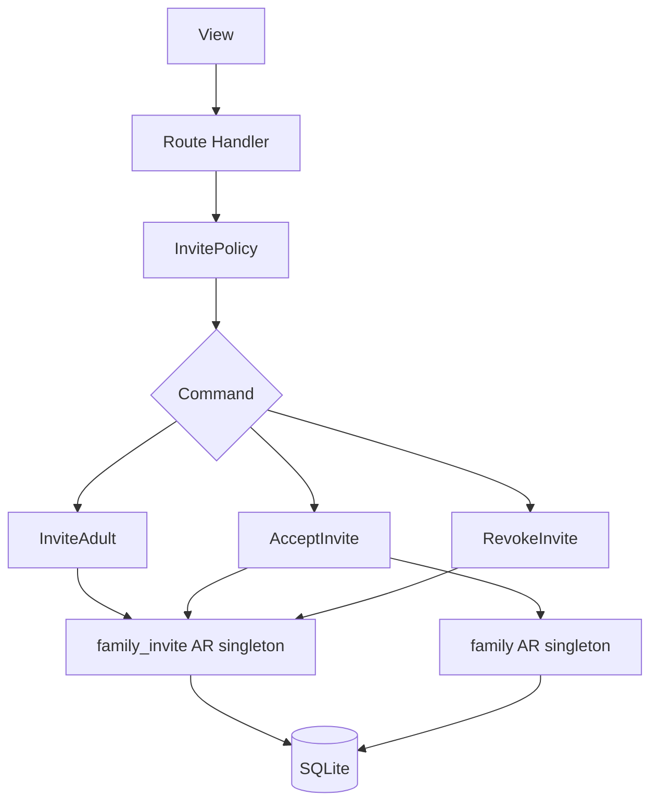

# TDD — Adult invite

## Header & Metadata

| Field | Value |
|-------|-------|
| Tech lead | Bruno |
| Team | Great Kids |
| Epic | prototype high-fidelity |
| Status | Draft |
| Date | 2026-10-19 |
| Size | Small |
| Harness | docs/harness/features/feature-adult-invite.md |

## Technical Solution

MVC: Route Handler is the controller. Titular invites another adult into the family via `family_invite` (not an auth table). Commands: invite, accept, revoke. Accept joins `family.family_members` envelope `{id, members:[]}`. Mock accept in the prototype (no email provider). Unidirectional: View → Route Handler → Policy → Command → Service → Active Record singleton → SQLite.

**Command:** InviteAdult (Pending + unique token_hash), AcceptInvite (Accepted + member row), RevokeInvite (Revoked). Expired token → status Expired, do not join. **Policy:** only titular (or Admin) invites; invited Parent uses the app but cannot change plan; Child context cannot invite.

Data flow: (1) Titular posts email + role Parent. (2) Policy 403 if non-titular. (3) InviteAdult stores Pending, unique token_hash, expires_at. (4) Accept: if expired, mark Expired and stop. (5) Else Accepted and append member envelope. (6) Revoke sets Revoked.

| Method | Path | Request | Response |
|--------|------|---------|----------|
| POST | /api/families/{id}/invites | `{"email":"pai@example.com","role":"Parent"}` | `201 {"id":"<uuid>","family_id":"<id>","email":"pai@example.com","role":"Parent","status":"Pending","expires_at":"<iso>"}` |
| PATCH | /api/families/{id}/invites | `{"id":"<uuid>","action":"accept"}` | `200 {"id":"<uuid>","status":"Accepted"}` |
| PATCH | /api/families/{id}/invites | `{"id":"<uuid>","action":"revoke"}` | `200 {"id":"<uuid>","status":"Revoked"}` |

Non-titular POST → 403. Expired accept → `{"status":"Expired"}` 409, member not added. Duplicate token_hash → 409.

**Schema (existing):** `family_invite`: id, family_id, email, role (Parent\|Child), status (Pending\|Accepted\|Revoked\|Expired), token_hash UNIQUE, expires_at, created_at, updated_at. `family.family_members` envelope members `{user_id, user_nickname, user_role}`.

**Migration:** Wave 0 applies the full SQLite schema. This feature uses existing tables.

## Context Pillars

### Descrição
"Convidar outros adultos da família, que passam a acessar o app. Sugestão de dois papéis: titular (plano e dados da família) e adulto (usa tudo, sem alterar o plano)."

### Problema
More than one adult should use the app without sharing one login or changing the plan.

### Solução e trade-offs
`family_invite` (Pending, Accepted, Revoked, Expired), token_hash unique. Not an auth table. Trade-off: mock accept in prototype vs email provider.

### Exemplo / contexto
`great-kids-funcionalidades.md` Convite de adultos. Schema `family_invite`.

## Context

A household often has two adults. The titular owns plan and family data; the invited adult should use missions, diary, and quizzes without sharing the titular identity. Invites live on `family_invite` with hashed tokens — not passwords, not auth.users.

Prototype accept is mock: no mailer. Status machine must still be real so support (later) can see Pending vs Accepted. Stakeholders: titular, invited adult, Bruno, Scultore.

## Problem Statement & Motivation

One shared titular login makes it impossible to show “adulto usa tudo, sem alterar o plano” — the commissioner cannot tell ownership from daily use. If non-titular can invite, strangers join the household JSON (PII leak). Expired tokens that still join leave unbounded access after a demo link is reused.

## Scope

**In Scope (V1):** POST invite as titular; statuses Pending/Accepted/Revoked/Expired; unique token_hash; mock accept into family_members; revoke; 403 for non-titular; invited adult cannot change plan.

**Out of Scope:** Email provider, magic links, passwords, auth tables; Child-role invites as logins; panel impersonation; invite quotas.

**Future:** Send email; expiry jobs; re-invite; titular transfer.

## Risks

| Risk | Impact | Prob. | Mitigation |
|------|--------|-------|------------|
| Raw token stored | H | M | Persist token_hash only; never log token |
| Expired accept joins | H | M | Command checks expires_at; set Expired |
| Non-titular invites | M | M | InvitePolicy 403 |

## Implementation Plan

| Phase | Task | TDD cycle | Owner | Estimate |
|-------|------|-----------|-------|----------|
| 1 | InvitePolicy | Red: non-titular 403; invited cannot change plan → Green: Policy | Bruno | 0.5d |
| 2 | Commands + family_invite AR | Red: statuses, unique token_hash, expired skip join → Green: singleton | Bruno | 1d |
| 3 | POST/PATCH /api/families/{id}/invites | Red: integration 201/200/403/409 → Green: Route Handler | Bruno | 0.5d |

## Testing Strategy

| Type | Scope | Approach |
|------|-------|----------|
| Unit (Vitest) | Commands, Policy, unique hash | Status machine; expired; plan denial |
| Integration (Vitest) | Route Handlers | POST/PATCH invites; member envelope after accept |
| Frontend | — | No unit tests. Pittore browser: titular invite control |

**Critical (aceite):** invite statuses enforced; accepted adult cannot change plan; token_hash unique.

## Security Considerations

Mock session; roles Admin/Operator/Parent/Child. Only titular Parent (or Admin) creates invites. Invites are not auth tables; no passwords; no `.env` writes. Email is PII — do not log. token_hash unique; never return raw token after create. No child photos. Child context cannot invite. Real name allowed on `app_user` when the adult later exists.
