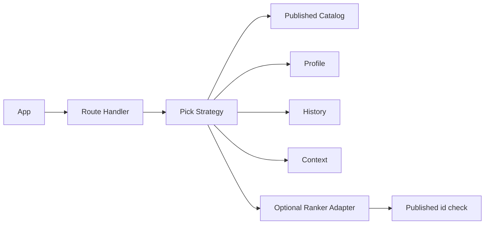

# TDD: Mission pick rules

## 1. Header & Metadata

| Field | Value |
|-------|-------|
| Tech lead | Bruno |
| Team | Great Kids |
| Epic | prototype high-fidelity |
| Status | Draft |
| Date | 2026-10-19 |
| Size | Small |

## 2. Technical Solution

Pick returns one catalog `mission` id that is published, active, and not deleted. The system never invents a mission (INV-001). Family APIs never return draft/in_review (INV-005). An optional ranker Adapter may order published ids; if it returns free text or an unpublished/unknown id, discard and error. No ORM. Response is a catalog id only.

**Patterns (all required):** Strategy scores/filters published rows by profile, ages, history (skip recent non-repeatable), and forecast context. Adapter wraps an optional ranker; the handler still validates the id exists on `mission` with `review_status=published`.

**Security note:** unpublished missions are panel-only. Ranker output is never trusted as copy. Family POST pick returns `{ id, mission_id }` only.

**Wave 0 owns DDL** for `mission`, `family_profile`, `family_mission`, `mission_forecast_context`. This feature adds no tables.

**Schema used:** `mission` published/active/not-deleted, `repeatable`, ages, values envelope. Profile envelopes (skip deleted answers). `family_mission` Completed history. Context join optional.

| Method | Path | Auth | Request | Response |
|--------|------|------|---------|----------|
| POST | /api/families/{id}/missions/pick | Parent of family | `{ context_id? }` | `{ id, mission_id }` |

Errors: no published candidate → empty/error, never generated title/body. Ranker free-text or unknown id → discard; error. Recent non-repeatable Completed → skip that id.

## 3. Context Pillars

**How do you describe the feature?**
"A IA escolhe apenas entre atividades já aprovadas, sem inventar missões. Considera perfil, gostos, idades, histórico (para não repetir) e contexto (clima, dia da semana)."

**What problem does it objectively solve?**
Unconstrained generation would invent activities the staff never approved.

**What is the expected solution? What trade-offs does it involve?**
Selector over published missions using profile, ages, history (skip unless repeatable), context. Trade-off: rules engine vs LLM prose; LLM may rank but must return a catalog id.

**What example or context do we have of the problem and the solution?**
`great-kids-funcionalidades.md` Regras da IA. INV-001.

## 4. Context

Surprise, weekly, and mascot delivery all choose from the same approved catalog. “IA” in product copy is selection among published rows, not generated activities.

Staff review is the gate. Profile and context only rank inside that set.

## 5. Problem Statement & Motivation

An unconstrained model would invent missions families cannot complete from the catalog (INV-001). Returning draft ids leaks unreviewed copy (INV-005). Repeating a recent non-repeatable mission breaks the cycle. Cost of delay: surprise/weekly/mascot cannot ship safely.

## 6. Scope

**In scope (V1):** POST pick; published catalog id only; skip recent non-repeatable; optional Adapter still validated; profile/context/ages as filters.

**Out of scope:** generated mission prose as the result; family creating catalog rows; live weather; jobs.

**Future:** stronger ranker; weekday strategy; explain-why without new missions.

## 7. Risks

| Risk | Impact | Probability | Mitigation |
|------|--------|-------------|------------|
| Ranker invents a mission | H | M | Discard non-catalog/non-published ids |
| Draft id returned | H | M | Published filter after Adapter |
| Repeat non-repeatable | M | M | Skip recent Completed unless repeatable |

## 8. Implementation Plan

Each phase is Red (failing Vitest) then Green (minimal code), then refactor.

| Phase | Task | TDD cycle | Owner | Estimate |
|-------|------|-----------|-------|----------|
| 1 – Strategy | Published-only pick | Red: draft id returned → Green: catalog filter | Scultore | 0.5d |
| 2 – History | Skip non-repeatable | Red: recent Completed returned → Green: skip rule | Scultore | 0.5d |
| 3 – Adapter | Optional ranker | Red: free-text accepted → Green: validate published id | Scultore | 0.5d |

## 9. Testing Strategy

| Type | Scope | Approach |
|------|-------|----------|
| Unit | Strategy, Adapter | Vitest: draft rejected; unknown id discarded; skip non-repeatable |
| Integration | POST pick | Vitest: response is catalog id; never a free-text mission |

Critical: pick never returns draft; pick never returns a mission id not in the table; non-repeatable recently completed is skipped.
