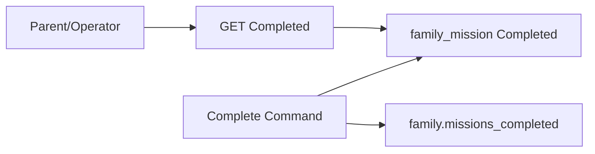

# TDD — Completed missions history

## Header & Metadata

| Field | Value |
|-------|-------|
| Tech lead | Bruno |
| Team | Great Kids |
| Epic | prototype high-fidelity |
| Status | Draft |
| Date | 2026-10-19 |
| Size | Small |

## Technical Solution

History is `family_mission` where `status = Completed`, plus hub counter `family.missions_completed`. The complete write (Command) updates the counter in the same transaction as status so the hub cannot drift. List may show a title stored on the cycle row even if the catalog is later unpublished. Family surfaces still never pick unpublished rows for new work (INV-001). MVC, unidirectional: View → Route Handler → Service → Model.

**GoF (required):**
- **Command** — CompleteMission is the single write that sets Completed, stores closing (from cycle), increments `missions_completed`, and snapshots display title on the row. GET is the read of that command’s outcomes, not a second writer.

**Data flow:** 1) Complete Command succeeds only on a legal cycle row. 2) Counter increments by one. 3) Non-repeatable second complete rejected (no extra increment). 4) GET `status=Completed` returns those rows for the family. 5) Empty family → empty envelope, not an error splash.

**API**

| Method | Resource | Request | Response |
|--------|----------|---------|----------|
| GET | `/api/families/{id}/missions?status=Completed` | — | `{ "id", "missions": [{ "id", "mission_id", "status": "Completed", "title", "completed_at", "closing" }] }` |

**Persistence:** query `family_mission` by `fam_id` + Completed; increment `family.missions_completed` on complete. No history table. Title lives on the cycle row. Additive snapshot field if the row lacks it.

## Context Pillars

### Descrição
> "Histórico das missões que a família concluiu."

### Problema
Families need to see what they already did (and staff need the same for indicators).

### Solução e trade-offs
History = `family_mission` where status Completed, plus `missions_completed` on `family`. Trade-off: counter on hub vs COUNT; hub counter must stay in sync on complete.

### Exemplo / contexto
`great-kids-funcionalidades.md` Missões completas.

## Context

The cycle produces Completed rows. The family hub stores a denormalized counter for the Parent home. Operators later count the same rows for the panel. History is not the live catalog: a mission can leave published after the family already finished it.

Stakeholders: Parent (history), Operator (indicators), cycle writers.

## Problem Statement & Motivation

Without a Completed list, the family cannot see their own week of wins, and staff cannot trust panel counts. If complete does not bump `missions_completed`, the hub lies relative to the rows.

If skipped, diary mission links and indicators have no source of truth. Why now: cycle writes Completed.

## Scope

### In Scope (V1)
- GET list equals Completed rows for the family
- Increment `missions_completed` on complete (same transaction)
- Historical title from the cycle row if catalog unpublished

### Out of Scope (V1)
- Drafts in the history list
- Recompute counter with a nightly job
- Editing completed copy in place

### Future (V2+)
- Filters by type/period
- Repair endpoint if counter drifts
- Share a memory from a history row

## Risks

| Risk | Impact | Probability | Mitigation |
|------|--------|-------------|------------|
| Counter drift | H | M | Increment inside complete Command |
| Second complete on non-repeatable | H | M | Reject; no increment |
| Live catalog join hides old title | M | M | Snapshot title on the cycle row |

## Implementation Plan

Each phase starts Red (failing Vitest) then Green (minimal pass), then refactor.

| Phase | Task | TDD cycle | Owner | Estimate |
|-------|------|-----------|-------|----------|
| 1 | GET Completed envelope | Red: drafts included → Green: Completed only | Great Kids | 0.5d |
| 2 | Complete Command counter | Red: row without increment → Green: txn | Great Kids | 0.5d |
| 3 | Title snapshot | Red: unpublished hides row → Green: stored title | Great Kids | 0.25d |

## Testing Strategy

| Type | Scope | Approach |
|------|-------|----------|
| Unit (Vitest) | Command | increment; reject second non-repeatable |
| Integration (Vitest) | GET | list = Completed rows |
| Contract | JSON | `{ id, missions: [] }` |

Critical: list equals Completed; counter increments; unpublished catalog still shows stored title.
