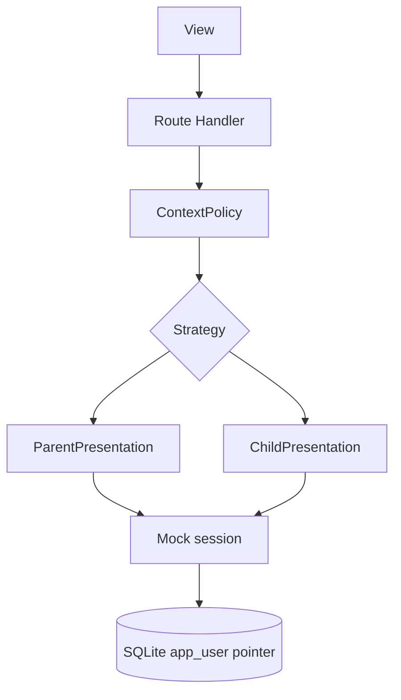

# TDD — Mock session and context switch

## Header & Metadata

| Field | Value |
|-------|-------|
| Tech lead | Bruno |
| Team | Great Kids |
| Epic | prototype high-fidelity |
| Status | Draft |
| Date | 2026-10-19 |
| Size | Small |
| Harness | docs/harness/features/feature-context-switch.md |

## Technical Solution

MVC: Route Handler is the controller. Mock session starts as Parent (titular). POST `/api/session/context` sets presentation role Parent or Child. Child is a view, not an `app_user` login (INV-002). Unidirectional: View → Route Handler → Policy → SessionContext (Strategy) → JSON → View. Family APIs read the mock role; they do not write a child account. Panel Admin/Operator mock is a separate session surface.

**Strategy:** ParentPresentation vs ChildPresentation — which family screens and mutations are offered. **Policy:** ContextPolicy — default Parent; Child cannot change plan or invite adults; no mock session → do not call family APIs as authenticated Parent.

Data flow: (1) Prototype opens; session role = Parent. (2) View posts `{role}`. (3) Handler parses. (4) Policy validates Parent\|Child. (5) Strategy stores presentation role on mock session. (6) Subsequent family writes consult Policy; Child gets 403 on plan/invite.

| Method | Path | Request | Response |
|--------|------|---------|----------|
| POST | /api/session/context | `{"role":"Child"}` | `200 {"role":"Child","presentation":"child"}` |
| POST | /api/session/context | `{"role":"Parent"}` | `200 {"role":"Parent","presentation":"parent"}` |

Invalid role → 400. Child posting plan/invite → 403, role stays Child. Missing session → 401 on family APIs.

**Schema (existing):** `app_user.role` Admin \| Operator \| Parent \| Child; `auth_user_id` nullable unique pointer. No session/auth tables. Mock role is process/session state, not a new column.

**Migration:** Wave 0 applies the full SQLite schema. This feature uses existing tables.

## Context Pillars

### Descrição
"Sessão Mock como Parent, mas quero que o user possa trocar de contexto, vendo as visões child no app"

### Problema
This prototype has no Supabase Auth. The commissioner still needs to see Parent and Child screens.

### Solução e trade-offs
Mock session starts as Parent. A control switches to Child views in the emulated app. Trade-off: not real auth; `auth_user_id` stays a pointer. Child is a view, not an account (INV-002). Panel still uses Admin/Operator mock separately.

### Exemplo / contexto
User answer in harness-create. Schema: `app_user.role` Admin | Operator | Parent | Child; `auth_user_id` nullable.

## Context

The prototype has no Supabase Auth. The commissioner starts as Parent inside the family surface and must preview Child screens without creating a child login. Panel staff mock (Admin/Operator) is independent and must not be confused with this switch.

`auth_user_id` remains a nullable pointer for a later bind. Child context must not mutate titular data. Stakeholders: commissioner, Bruno, Scultore (session Policy), Pittore (Parent/Child screens).

## Problem Statement & Motivation

Without a switch, Child screens cannot be demoed except by forging a Child `app_user`, which violates INV-002 and trains the product as if children had logins. If Child context can change plan or invite, titular ownership collapses — impact is incorrect prototype decisions and broken adult-invite demos. Unauthenticated family API calls as Parent would leak household PII in a walkthrough.

## Scope

**In Scope (V1):** Default mock session Parent; switch to Child presentation without creating a child login; Policy deny plan/invite in Child; 401 when no mock session; panel Admin/Operator mock remains separate.

**Out of Scope:** Real auth, passwords, auth tables; Child `app_user` rows for login; panel context switch; device biometrics.

**Future:** Supabase session; persist last presentation per adult; guardian PIN to leave Child view.

## Risks

| Risk | Impact | Prob. | Mitigation |
|------|--------|-------|------------|
| Child context mutates plan | H | M | ContextPolicy on every plan/invite write |
| Switch creates Child account | H | L | Strategy only changes presentation; no `app_user` insert |
| Family APIs without session | M | M | 401 when mock session absent |

## Implementation Plan

| Phase | Task | TDD cycle | Owner | Estimate |
|-------|------|-----------|-------|----------|
| 1 | ContextPolicy | Red: Child plan/invite denied; no session 401 → Green: Policy | Bruno | 0.5d |
| 2 | Parent vs Child Strategy | Red: default Parent; switch does not insert user → Green: strategies | Bruno | 0.5d |
| 3 | POST /api/session/context | Red: integration 200/400/403 → Green: Route Handler | Bruno | 0.5d |

## Testing Strategy

| Type | Scope | Approach |
|------|-------|----------|
| Unit (Vitest) | Policy + Strategy | Default Parent; Child cannot change plan; no child login row |
| Integration (Vitest) | Route Handler | POST context; family writes honor role |
| Frontend | — | No unit tests. Pittore browser: Child views after switch |

**Critical (aceite):** default session is Parent; switch shows Child views without creating a child login; Child context cannot change plan.

## Security Considerations

Mock session only; no auth tables; no `.env` writes. Roles Admin/Operator/Parent/Child — this switch is Parent↔Child presentation on the family surface. Child is not an account; no child photos. Real name allowed on members elsewhere. Do not log session tokens or PII. Panel Admin/Operator must not inherit Child switch.
