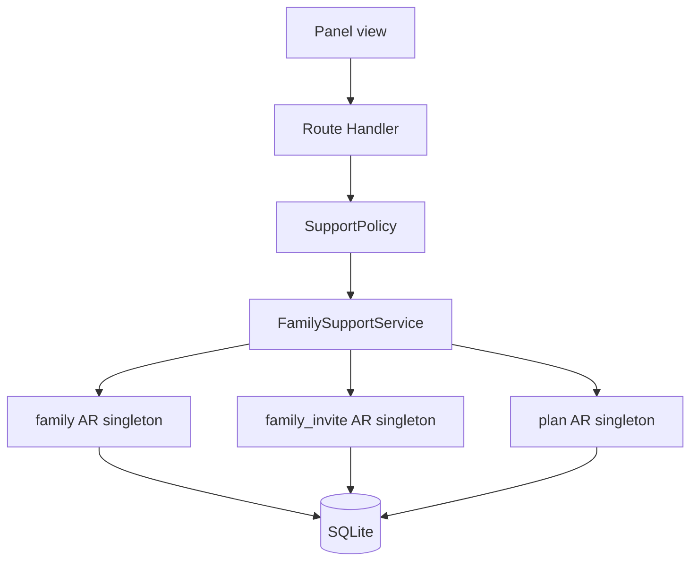

# TDD — Families and subscriptions (support)

## Header & Metadata

| Field | Value |
|-------|-------|
| Tech lead | Bruno |
| Team | Great Kids |
| Epic | prototype high-fidelity |
| Status | Draft |
| Date | 2026-10-19 |
| Size | Small |
| Harness | docs/harness/features/feature-families-subscriptions.md |

## Technical Solution

MVC: Route Handler is the controller. Support panel reads family account, invites, and plan without impersonating the titular session. Seed one Free `plan`. `family.plan_id` optional; ON DELETE RESTRICT if still referenced. Unidirectional: Panel View → Route Handler → Policy → Service → Active Record singletons → SQLite.

**Policy:** Operator and Admin read/manage panel families; Parent 403 on `/api/panel/*`; titular Parent may change plan on family APIs; invited adult cannot. **Singleton:** Active Record for `family`, `family_invite`, `plan`.

Data flow: (1) Operator GET panel families. (2) Policy allows Operator/Admin. (3) Service lists family status, plan, invites. (4) PATCH plan_id when policy allows. (5) Delete plan still referenced → DB RESTRICT. (6) Family create still requires profile+diary husk (adult-holder).

| Method | Path | Request | Response |
|--------|------|---------|----------|
| GET | /api/panel/families | — | `200 {"id":"<list>","families":[{"id":"<fam>","status":"active","plan":{"id":"<plan>","name":"Free","status":"active"},"invites":[{"id":"<inv>","email":"a@b.c","status":"Pending"}]}]}` |
| PATCH | /api/panel/families/{id}/plan | `{"plan_id":"<uuid>"}` | `200 {"id":"<fam>","plan_id":"<uuid>"}` |

Parent on panel GET/PATCH → 403. Unknown plan_id → 404. Delete referenced plan → 409 RESTRICT.

**Schema (existing):** `plan`: id, name, status (active\|inactive), timestamps; unique name. `family.plan_id` nullable FK RESTRICT. `family_invite` as in adult-invite. Family insert still needs `fam_profile_id` and `fam_diary_id`.

**Migration:** Wave 0 applies the full SQLite schema (includes Free plan seed). This feature uses existing tables.

## Context Pillars

### Descrição
"Visão de suporte: conta da família, convites e plano."

### Problema
Staff need to see a family account, invites, and plan without impersonating incorrectly.

### Solução e trade-offs
Panel read/manage of `family`, `family_invite`, `plan`. Trade-off: optional `plan_id`; one seeded Free plan; no payments in this prototype.

### Exemplo / contexto
`great-kids-funcionalidades.md` Famílias e assinaturas. Schema `plan`, `family_invite`.

## Context

Support must inspect a household: status, invites, plan. They work on the web panel, not inside the phone shell, and must not become the titular. Prototype has no payments; a seeded Free plan is enough to show assignment.

Family rows cannot be created without profile and diary FKs (husk). Stakeholders: Operator, Admin, titular, Bruno, Scultore.

## Problem Statement & Motivation

Without a panel list, staff debug families by guessing SQLite rows — impact is slow support and accidental impersonation. If Parent can hit panel routes, titular data leaks into the staff surface. Deleting the Free plan while families reference it orphans `plan_id` (RESTRICT must fail the delete).

## Scope

**In Scope (V1):** GET panel families with status, plan, invites; PATCH plan; Free plan seed; Policy Operator/Admin vs Parent; RESTRICT on referenced plan delete; family insert still requires profile+diary.

**Out of Scope:** Payments, invoices, gateways; impersonate titular; custom plans UI; dunning.

**Future:** Paid plans; billing provider; audit log of plan changes.

## Risks

| Risk | Impact | Prob. | Mitigation |
|------|--------|-------|------------|
| Parent uses panel | H | M | SupportPolicy 403 on /api/panel/* |
| Orphan plan_id | M | L | FK ON DELETE RESTRICT |
| Missing Free seed | M | M | Wave 0 seed; test seed exists |

## Implementation Plan

| Phase | Task | TDD cycle | Owner | Estimate |
|-------|------|-----------|-------|----------|
| 1 | SupportPolicy | Red: Parent 403; Operator 200; titular-only plan on family API → Green: Policy | Bruno | 0.5d |
| 2 | plan + family AR | Red: seed Free; RESTRICT delete; husk FKs → Green: singletons | Bruno | 0.5d |
| 3 | GET /api/panel/families, PATCH plan | Red: integration list + patch → Green: Route Handlers | Bruno | 0.5d |

## Testing Strategy

| Type | Scope | Approach |
|------|-------|----------|
| Unit (Vitest) | Policy, FK, seed | Parent deny; Free exists; RESTRICT |
| Integration (Vitest) | Panel routes | GET families; PATCH plan |
| Frontend | — | No unit tests. Pittore browser: panel family view, no phone chrome |

**Critical (aceite):** family insert requires profile and diary; Free plan seed exists; Parent cannot change plan unless titular policy says so.

## Security Considerations

Mock session; panel roles Admin/Operator; Parent 403 on panel. No impersonation of titular. Plan change: titular or Admin/Operator per Policy; invited adult cannot. PII in list (invite emails) — do not log. No payments, no card data, no `.env` writes, no auth tables. No child photos.
