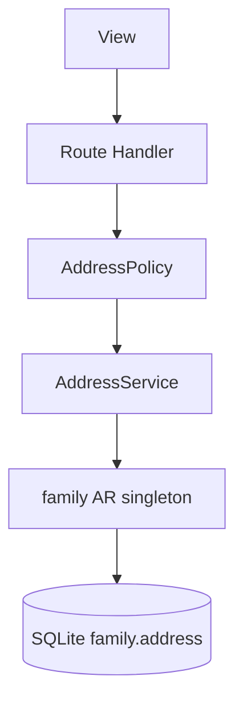

# TDD — Family address

## Header & Metadata

| Field | Value |
|-------|-------|
| Tech lead | Bruno |
| Team | Great Kids |
| Epic | prototype high-fidelity |
| Status | Draft |
| Date | 2026-10-19 |
| Size | Small |
| Harness | docs/harness/features/feature-family-address.md |

## Technical Solution

MVC: Route Handler is the controller. Address is a plain JSON object on `family` (not an envelope): `{street, number, neighborhood, city, state, zip_code}`. Generated stored columns `city` and `state` are indexed for forecast/city filters. Unidirectional: View → Route Handler → Policy → Service → family Active Record singleton → SQLite.

**Singleton:** Active Record `family` — one accessor writes `address` JSON via `queryRaw`; generated `city`/`state` come from the engine, not app copies.

Data flow: (1) Titular PUTs address object. (2) Handler requires object keys, not `{id, key:[]}`. (3) Invalid JSON → 400. (4) Empty city allowed. (5) Singleton updates `address`; DB fills generated city/state. (6) Response echoes object plus generated fields.

| Method | Path | Request | Response |
|--------|------|---------|----------|
| PUT | /api/families/{id}/address | `{"street":"Rua A","number":"10","neighborhood":"Centro","city":"Curitiba","state":"PR","zip_code":"80000-000"}` | `200 {"street":"Rua A","number":"10","neighborhood":"Centro","city":"Curitiba","state":"PR","zip_code":"80000-000"}` |

Invalid JSON / wrong shape → 400. Non-titular and non-Admin → 403. Empty city → 200; suggestions may skip city filter.

**Schema (existing):** `family.address` JSON object; generated `city` = json_extract(address, '$.city'); generated `state` = json_extract(address, '$.state'); indexes ix_family_city, ix_family_state.

**Migration:** Wave 0 applies the full SQLite schema. This feature uses existing tables.

## Context Pillars

### Descrição
"Endereço da família (ver decisão em aberto sobre o nível de detalhe)."

### Problema
Forecast and city activities need where the family is.

### Solução e trade-offs
Full address JSON `{ street, number, neighborhood, city, state, zip_code }` as in the draft. Generated indexed `city` / `state`. Trade-off: draft stored full address even though funcionalidades says city/region might suffice.

### Exemplo / contexto
`database-draft.md` address jsonob. Schema generated columns.

## Context

Forecast contexts and city activities need a location. The study schema stores a full street address and projects city/state as generated indexed columns so reads do not parse JSON each time.

Funcionalidades still treat detail level as open; V1 follows the draft object. Address is PII. Only titular or Admin updates it. Stakeholders: titular, later suggestion services, Bruno, Scultore.

## Problem Statement & Motivation

Without a queryable city/state, weekly/city suggestions cannot filter — impact is generic missions and a weak forecast demo. If address is stored as an INV-004 envelope, generated columns miss `$.city` and indexes go empty. If any Parent (invited adult) can rewrite address, household PII is editable by non-owners.

## Scope

**In Scope (V1):** PUT plain address object; generated city/state match JSON; titular or Admin only; invalid JSON rejected; empty city allowed.

**Out of Scope:** Geocoding, maps, CEP lookup; reducing to city-only; invited adult edits; history of moves.

**Future:** City/region-only mode; geocode; privacy-redacted display.

## Risks

| Risk | Impact | Prob. | Mitigation |
|------|--------|-------|------------|
| Envelope used instead of object | M | M | Reject `{id, ...}` shape; tests for plain object |
| Generated city/state drift | M | L | DB generated columns; assert match after write |
| PII logged | H | L | Never log address; AddressPolicy on writes |

## Implementation Plan

| Phase | Task | TDD cycle | Owner | Estimate |
|-------|------|-----------|-------|----------|
| 1 | AddressPolicy | Red: non-titular 403 → Green: Policy | Bruno | 0.25d |
| 2 | family AR address write | Red: plain object; city/state match JSON → Green: singleton `queryRaw` | Bruno | 0.5d |
| 3 | PUT /api/families/{id}/address | Red: integration 200/400/403 → Green: Route Handler | Bruno | 0.5d |

## Testing Strategy

| Type | Scope | Approach |
|------|-------|----------|
| Unit (Vitest) | Model + Policy | Plain object; generated match; empty city |
| Integration (Vitest) | PUT address | Titular 200; invited 403; invalid JSON 400 |
| Frontend | — | No unit tests. Pittore browser: address form |

**Critical (aceite):** address is a plain object, not an envelope; city/state match JSON; only titular (or Admin) updates address.

## Security Considerations

Address is PII (street, zip). Mock session; roles Admin/Operator/Parent/Child — writes: titular Parent or Admin. No child photos; real name allowed elsewhere. No `.env` writes; no auth tables. Do not log address. Validate JSON at the handler; rate limiting TBD.
