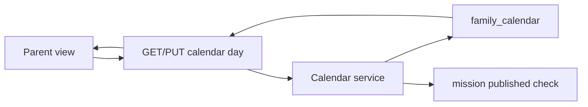

# TDD — Family calendar

## Header & Metadata

| Field | Value |
|-------|-------|
| Tech lead | Bruno |
| Team | Great Kids |
| Epic | prototype high-fidelity |
| Status | Draft |
| Date | 2026-10-19 |
| Size | Small |

## Technical Solution

One `family_calendar` row per family+day. Suggestions live in a JSON envelope `{ id, suggestions: [] }` with status `scheduled` \| `done` \| `moved`. Only **published** active missions may be scheduled (INV-001, INV-005). MVC, unidirectional: View → Route Handler → Service → Model. Unique `(family_id, day)` rejects a second row.

**GoF (both, required):**
- **Composite** — the day document is one object the client treats uniformly: the day and its suggestion children share the same envelope operations (read, replace suggestions list).
- **Command** — ScheduleOnDay and MoveSuggestion encapsulate writes; invoker is the Parent action, receiver is the day document.

**Data flow:** 1) GET returns the day composite or an empty suggestions envelope. 2) Schedule command checks published+active+not deleted. 3) PUT writes one row with envelope + optional `previous_weather`. 4) Duplicate `(family_id, day)` rejected. 5) Move command updates suggestion status to `moved` and writes the target day without duplicating the unique key.

**API**

| Method | Resource | Request | Response |
|--------|----------|---------|----------|
| GET | `/api/families/{id}/calendar/{day}` | — | `{ "id", "family_id", "day", "previous_weather", "notifications", "suggestions": { "id", "suggestions": [{ "id", "mission_id", "curated_material_id", "status" }] } }` |
| PUT | `/api/families/{id}/calendar/{day}` | `{ "suggestions": { "id", "suggestions": [...] }, "previous_weather" }` | same day document; 409 on unique clash; 422 if unpublished `mission_id` |

**Persistence:** `family_calendar` (`id`, `family_id`, `day`, `previous_weather`, `notifications`, `suggestions`). Envelope never a bare array (INV-004). Additive unique on `(family_id, day)`. No child suggestion table in V1.

## Context Pillars

### Descrição
> "Calendário em que a família programa atividades e inclui uma atividade em dias escolhidos."

### Problema
Families need a place to put a pick on a real day, not only a surprise button.

### Solução e trade-offs
`family_calendar` one row per family+day; suggestions envelope with status scheduled | done | moved; previous_weather. Trade-off: JSON suggestions vs child table.

### Exemplo / contexto
`great-kids-funcionalidades.md` Calendário da família. Schema `family_calendar`.

## Context

The family app needs a week the Parent can drop published missions onto. Staff already curate the catalog; weather is stored as `previous_weather` on the day, not a live feed. Weekly suggestion, reminders, and indicators all read this day document.

Stakeholders: Parent (schedule), Operator (later indicators), Scultore (envelope + unique).

## Problem Statement & Motivation

Without a day row, surprise is the only next action and the commissioner cannot see a week of family life. Duplicate day rows would split suggestions and break unique occupancy.

If skipped, weekly drop, done/moved, and scheduled counts have nowhere to live. Why now: it is the write hub for forecast and reminders.

## Scope

### In Scope (V1)
- Unique day row per family; suggestions envelope; statuses scheduled/done/moved
- Reject unpublished `mission_id`
- `previous_weather` and notifications boolean on the day

### Out of Scope (V1)
- Child table of suggestions
- Live weather API
- External calendar sync

### Future (V2+)
- Recurring rows from rhythms
- Time-of-day slots
- Shared view for a second Parent

## Risks

| Risk | Impact | Probability | Mitigation |
|------|--------|-------------|------------|
| Two writers insert the same day | H | M | Unique `(family_id, day)`; 409 |
| Unpublished id stored in envelope | H | M | Service rejects before write |
| Bare JSON array in `suggestions` | H | L | Envelope `{ id, suggestions: [] }` |

## Implementation Plan

Each phase starts Red (failing Vitest) then Green (minimal pass), then refactor.

| Phase | Task | TDD cycle | Owner | Estimate |
|-------|------|-----------|-------|----------|
| 1 | Composite day document + unique | Red: second row accepted → Green: 409 | Great Kids | 0.5d |
| 2 | Schedule command published-only | Red: draft id stored → Green: 422 | Great Kids | 0.5d |
| 3 | GET/PUT day envelope | Red: bare array → Green: envelope | Great Kids | 0.5d |

## Testing Strategy

| Type | Scope | Approach |
|------|-------|----------|
| Unit (Vitest) | Envelope + unique | Shape, duplicate day |
| Integration (Vitest) | GET/PUT | Unpublished reject; status literals |
| Contract | JSON | `{ id, suggestions: [] }` never a list root |

Critical: unique `(family_id, day)`; unpublished id rejected; envelope shape.
