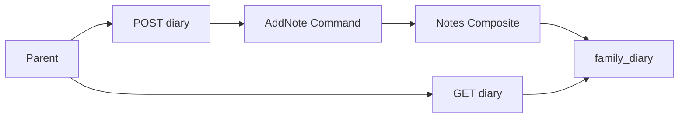

# TDD — Family diary

## Header & Metadata

| Field | Value |
|-------|-------|
| Tech lead | Bruno |
| Team | Great Kids |
| Epic | prototype high-fidelity |
| Status | Draft |
| Date | 2026-10-19 |
| Size | Small |

## Technical Solution

`family_diary.family_notes` is a JSON envelope `{ id, notes: [...] }` with `{ id, text, kind }` (INV-004). Text only — “Sem foto. Só história.” (INV-002). Photo/image payloads and empty text are rejected. Deleted diary flag hides notes in the app. MVC, unidirectional: View → Route Handler → Service → Model. Parent role on mock session; Child cannot author family notes.

**GoF (both, required):**
- **Composite** — the diary document and each note are treated uniformly as envelope nodes: the parent `{ id, notes }` and child notes share append/read without a notes table.
- **Command** — AddNote encapsulates append (kind + text); invoker is POST, receiver is the diary composite. Reject is a failed command, not a partial write.

**Data flow:** 1) GET returns envelopes or hides notes when `deleted`. 2) POST AddNote validates non-empty text and absence of image/photo fields. 3) Kind via note-types Strategy. 4) Append inside `family_notes` (and `mission_note` when linked). 5) Never store binary or image URLs for children.

**API**

| Method | Resource | Request | Response |
|--------|----------|---------|----------|
| GET | `/api/families/{id}/diary` | — | `{ "id", "family_notes": { "id", "notes": [...] }, "mission_note": { "id", "notes": [...] } }` or hidden notes when deleted |
| POST | `/api/families/{id}/diary` | `{ "text", "kind" }` | same envelopes; 422 empty text, photo/image payload, or unknown kind |

**Persistence:** `family_diary` (`family_notes`, `mission_note`, `deleted`). JSON document vs notes table (V1 document). No photo column.

## Context Pillars

### Descrição
> "Adicionar notas como um diário da família."

### Problema
The product must keep what happened, not only suggest what to do.

### Solução e trade-offs
`family_diary.family_notes` envelope. Text only — “Sem foto. Só história.” Trade-off: JSON document vs notes table.

### Exemplo / contexto
`great-kids-funcionalidades.md` Diário. Apresentação “Sem foto. Só história.”

## Context

Great Kids memories are stories, never a child profile photo. The diary hub is created with the family. Note types and mission links write into the same document.

Stakeholders: Parent (author), Child (no account/photo), Operator (must not scrape images).

## Problem Statement & Motivation

A suggest-only app forgets the week, so the commissioner cannot see a living family. Photo upload would violate “the child is never a photo” and store illegal-for-product imagery.

If skipped, `save_memory` closing has no home. Why now: note kinds and cycle exist.

## Scope

### In Scope (V1)
- GET/POST diary envelopes `{ id, notes: [...] }`
- Reject photo/image payload and empty text
- Deleted flag hides notes in the app

### Out of Scope (V1)
- Child photos, avatars, or media library
- Notes relational table
- Public sharing of diary

### Future (V2+)
- Export text memories
- Soft-delete a single note
- Operator read-only audit of text (no images)

## Risks

| Risk | Impact | Probability | Mitigation |
|------|--------|-------------|------------|
| Image stored on a note | H | M | Reject photo keys/URLs/binaries |
| Empty text persisted | M | H | 422 |
| Deleted diary still listed | M | M | GET hides notes when deleted |

## Implementation Plan

Each phase starts Red (failing Vitest) then Green (minimal pass), then refactor.

| Phase | Task | TDD cycle | Owner | Estimate |
|-------|------|-----------|-------|----------|
| 1 | Composite GET envelope | Red: bare array → Green: `{ id, notes }` | Great Kids | 0.5d |
| 2 | AddNote Command | Red: empty/photo stored → Green: 422 | Great Kids | 0.5d |
| 3 | Deleted hides notes | Red: deleted still returns notes → Green: hide | Great Kids | 0.25d |

## Testing Strategy

| Type | Scope | Approach |
|------|-------|----------|
| Unit (Vitest) | Command | empty text; photo reject |
| Integration (Vitest) | GET/POST | persist `{ id, notes }`; deleted hide |
| Contract | JSON | no image fields |

Critical: note persisted in `{ id, notes: [...] }`; no image payload; deleted hides notes.

## Security Considerations

Authn: mock session; Parent authors, Child does not. Authz: family-scoped diary id only. In transit: same app TLS in deploy; at rest: text JSON, no media bucket. PII: real names allowed in text; **no child photos, avatars, or image URLs** (INV-002). Retention: deleted flag hides in app; no public CDN. Compliance: LGPD — memories are family text, not biometric or image of a minor. Input: reject `photo`, `image`, `img`, binary, data-URI. Rate limit TBD. Audit: do not log raw note text in aggregates. Secrets: none in diary payloads.
