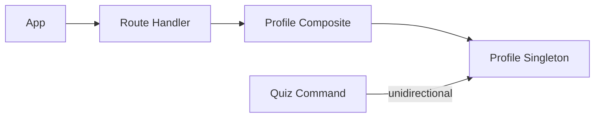

# TDD: Family profile (Family GPS)

## 1. Header & Metadata

| Field | Value |
|-------|-------|
| Tech lead | Bruno |
| Team | Great Kids |
| Epic | prototype high-fidelity |
| Status | Draft |
| Date | 2026-10-19 |
| Size | Small |

## 2. Technical Solution

Read the family GPS document: quiz answers, rhythms, achievements, profile_notes. Family requires `fam_profile_id`. GPS is a family document, never a child profile (INV-002). Envelopes are `{ id, <key>: [] }` (INV-004). Quiz writes into the profile in one direction only. No ORM.

**Patterns (all required):** Composite treats quiz_answer, rhythms, and achievements as one GPS document. Observer is unidirectional only: quiz service notifies the profile model; profile never calls quiz (no cycle).

**Wave 0 owns DDL** for `family_profile` and `family.fam_profile_id`. This feature does not add tables.

**Schema:** `family_profile` (id, quiz_answer, rhythms, achievements, profile_notes, deleted, timestamps). Envelopes: quiz_answer `{ id, answers: [{ question_id, answer_text, deleted }] }`; rhythms `{ id, rhythms: [{ id, label, source_mission_id, weekday }] }`; achievements `{ id, achievements: [{ id, label, earned_at }] }`. Family FK unique NOT NULL. Soft-deleted profile: family app hides GPS; panel can restore.

| Method | Path | Auth | Request | Response |
|--------|------|------|---------|----------|
| GET | /api/families/{id}/profile | Parent of family | — | `{ id, quiz_answer, rhythms, achievements, profile_notes }` |

Errors: missing profile row — family cannot exist. Soft-deleted → family app hides GPS (empty/error), panel may still read.

## 3. Context Pillars

**How do you describe the feature?**
"Respostas do Family GPS (o que importa para nós, o que queremos mais), ritmos da família e histórico de conquistas."

**What problem does it objectively solve?**
Without a living map of values and rhythms, suggestions are generic.

**What is the expected solution? What trade-offs does it involve?**
`family_profile`: quiz_answer, rhythms, achievements envelopes; profile_notes. Trade-off: GPS grows from quiz over time (“Don't interview the family. Discover the family.”) not a long onboarding form.

**What example or context do we have of the problem and the solution?**
Idea Book FAMILY GPS. `great-kids-funcionalidades.md` Perfil da família.

## 4. Context

The Idea Book’s Family GPS is the living map pick uses. It is not a child account or photo (INV-002). It fills from quiz answers over time, not a long intake form.

Staff do not author the GPS. Parents read it here; they edit facts on “what we know”.

## 5. Problem Statement & Motivation

Generic suggestions ignore values and rhythms. A family without `fam_profile_id` breaks the hub. Treating GPS as a child profile violates INV-002. Bare arrays break readers (INV-004). Cost of delay: pick and what-we-know have no document.

## 6. Scope

**In scope (V1):** GET profile envelopes; family requires fam_profile_id; GPS is not a child profile; unidirectional quiz → profile.

**Out of scope:** long onboarding form; child photo/profile; inventing missions; inferred graph beyond stored envelopes.

**Future:** compass UI copy; achievement earn rules; rhythm from completed missions.

## 7. Risks

| Risk | Impact | Probability | Mitigation |
|------|--------|-------------|------------|
| Quiz ↔ profile cycle | H | M | Observer one way: quiz → profile |
| GPS treated as child profile | H | L | INV-002 tests; no child photo fields |
| Missing profile on family create | H | M | fam_profile_id required |

## 8. Implementation Plan

Each phase is Red (failing Vitest) then Green (minimal code), then refactor.

| Phase | Task | TDD cycle | Owner | Estimate |
|-------|------|-----------|-------|----------|
| 1 – Envelopes | Composite read | Red: bare array accepted → Green: envelope checks | Scultore | 0.5d |
| 2 – GET | /api/families/{id}/profile | Red: missing FK allowed → Green: handler + require profile | Scultore | 0.5d |
| 3 – Observer | Quiz write-back | Red: profile calls quiz → Green: unidirectional notify | Scultore | 0.25d |

## 9. Security Considerations

Parent of the family only. GPS holds PII answers, rhythms, and notes. No child profile or child photo (INV-002). TLS in deploy; at-rest TBD. Soft-deleted profile hidden from the family app. LGPD: visible facts, later edit/delete. Do not log raw quiz_answer or profile_notes. Validate envelope shape. Secrets out of logs. Family pick still uses published catalog ids only (INV-001).

## 10. Testing Strategy

| Type | Scope | Approach |
|------|-------|----------|
| Unit | Composite, Observer | Vitest: envelopes; one-way write |
| Integration | GET profile | Vitest: three envelopes; family requires fam_profile_id |

Critical: envelopes for quiz_answer, rhythms, achievements; family requires fam_profile_id; GPS is not a child profile (INV-002).
