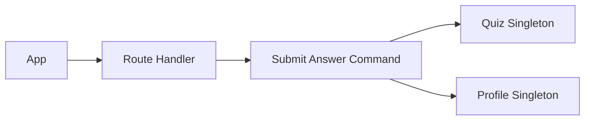

# TDD: Family quiz

## 1. Header & Metadata

| Field | Value |
|-------|-------|
| Tech lead | Bruno |
| Team | Great Kids |
| Epic | prototype high-fidelity |
| Status | Draft |
| Date | 2026-10-19 |
| Size | Small |

## 2. Technical Solution

Family answers staff questions. Offers come from the question bank (active, not deleted, kind Family-Quiz). Answers append to `family_profile.quiz_answer` as `{ id, answers: [{ question_id, answer_text, deleted }] }` (INV-004). Never invent questions or missions. No ORM. No new answer table.

**Patterns (all required):** Command encapsulates submit (validate question_id, append envelope). Singleton Active Record for `family_quiz` and `family_profile`.

**Wave 0 owns DDL** for `family_profile.quiz_answer` and `family_quiz`. This feature does not add tables.

**Schema:** quiz_answer envelope as above. `question_id` must exist on `family_quiz`. Deleted bank rows are not offered; existing answers remain until the family deletes them.

| Method | Path | Auth | Request | Response |
|--------|------|------|---------|----------|
| GET | /api/families/{id}/quiz | Parent of family | — | `{ id, questions: [{ id, question_text }] }` |
| POST | /api/families/{id}/quiz | Parent of family | `{ question_id, answer_text }` | `{ id, answers: [{ question_id, answer_text, deleted }] }` |

Errors: unknown question_id reject; empty answer_text reject. GET omits deleted bank questions. Child context cannot CRUD the bank.

## 3. Context Pillars

**How do you describe the feature?**
"Perguntas e respostas divertidas que a família responde para o app guardar informações e conhecer melhor a família, recomendando atividades melhores."

**What problem does it objectively solve?**
The app cannot recommend well without stored, playful answers about the family.

**What is the expected solution? What trade-offs does it involve?**
Answers append to `family_profile.quiz_answer` envelope `{ id, answers: [{ question_id, answer_text, deleted }] }`. Trade-off: answers in profile JSON vs answer table.

**What example or context do we have of the problem and the solution?**
`great-kids-funcionalidades.md` Quiz divertido. Schema quiz_answer.

## 4. Context

Family GPS grows from playful answers, not a long onboarding form. Staff write questions; the family app stores answers on the family profile. Pick rules later read non-deleted answers.

This is the write path. Modes (solo|table) share the same POST. “What we know” is the edit/delete surface.

## 5. Problem Statement & Motivation

Without stored answers, pick is generic. A bare array breaks envelope reads (INV-004). Unknown or deleted-offer question_ids corrupt the GPS. Cost of delay: profile, what-we-know, and pick have no facts.

## 6. Scope

**In scope (V1):** GET active Family-Quiz questions; POST answer into envelope; reject unknown question_id; deleted-answer flag hides later.

**Out of scope:** new answer table; inventing questions; staff editing family answers; mission invention.

**Future:** multiple answers per question; sampling by weight; Child-safe subset.

## 7. Risks

| Risk | Impact | Probability | Mitigation |
|------|--------|-------------|------------|
| PII answers leaked in logs | H | M | Never log answer_text |
| Bare answers array | H | M | Envelope validation |
| Answer to unknown question | H | M | Reject unknown question_id |

## 8. Implementation Plan

Each phase is Red (failing Vitest) then Green (minimal code), then refactor.

| Phase | Task | TDD cycle | Owner | Estimate |
|-------|------|-----------|-------|----------|
| 1 – Offer | GET quiz | Red: deleted bank row shown → Green: live Family-Quiz list | Scultore | 0.5d |
| 2 – Command | POST answer | Red: unknown id and bare array fail → Green: Command + envelope | Scultore | 0.5d |
| 3 – Hide | deleted on answer | Red: deleted answer still visible later → Green: flag | Scultore | 0.25d |

## 9. Security Considerations

Mock session: Parent of the family only. Child cannot CRUD the bank. Answers are PII (family tastes, names, rhythms). TLS in deploy; at-rest TBD (prototype SQLite). Retention: soft `deleted` on the answer, not a hard wipe of the question bank. LGPD: family can later edit/delete via what-we-know. Validate question_id and text length. Rate limit TBD. Audit: who wrote, not the raw answer. Never log secrets or raw PII. Input validation on Route Handler. Family APIs still only use published missions elsewhere (INV-001).

## 10. Testing Strategy

| Type | Scope | Approach |
|------|-------|----------|
| Unit | Command | Vitest: unknown id, envelope, deleted flag |
| Integration | GET/POST quiz | Vitest: answer references bank id; envelope not a bare array |

Critical: answer references family_quiz id; envelope not a bare array; deleted flag hides from “what we know”.
