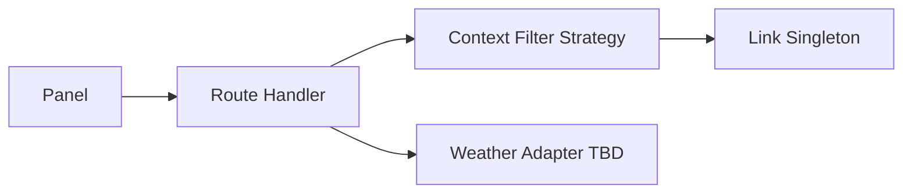

# TDD: Forecast contexts

## 1. Header & Metadata

| Field | Value |
|-------|-------|
| Tech lead | Bruno |
| Team | Great Kids |
| Epic | prototype high-fidelity |
| Status | Draft |
| Date | 2026-10-19 |
| Size | Small |

## 2. Technical Solution

Staff tag catalog missions with seeded forecast contexts (rain, holiday, christmas, back-to-school). Family pick may filter by context but only among published missions (INV-001, INV-005). No live weather feed in this prototype. No ORM. Lists use JSON envelopes.

**Patterns (all required):** Strategy applies a context filter over published catalog ids. Adapter is reserved for later weather; unused now. Calendar `previous_weather` is not a live feed.

**Security note:** tagging unpublished missions is allowed in the panel; family still only sees published.

**Wave 0 owns DDL** for `forecast_context` and `mission_forecast_context`. This feature seeds four slugs and writes links; it does not emit a second migration.

**Schema:** `forecast_context` (id, unique slug, name). Seeds: rain, holiday, christmas, back-to-school. `mission_forecast_context` (id, mission_id, context_id) UNIQUE (mission_id, context_id).

| Method | Path | Auth | Request | Response |
|--------|------|------|---------|----------|
| GET | /api/forecast-contexts | Staff | — | `{ id, contexts: [{ id, slug, name }] }` |
| PUT | /api/missions/{id}/contexts | Staff | `{ id, context_ids: [] }` | `{ id, context_ids: [] }` |

Errors: duplicate (mission_id, context_id) reject. Unknown context_id reject. Family pick with a context never invents a mission.

## 3. Context Pillars

**How do you describe the feature?**
"Gestão de contextos (chuva, feriado, Natal, volta às aulas) e de quais atividades combinam com cada um."

**What problem does it objectively solve?**
Suggestions should change with rain, holidays, Christmas, back-to-school — not only with family profile.

**What is the expected solution? What trade-offs does it involve?**
`forecast_context` seed (rain, holiday, christmas, back-to-school) + `mission_forecast_context`. Trade-off: staff-tagged fit vs live weather API (weather is `previous_weather` on calendar, not a live feed in this prototype).

**What example or context do we have of the problem and the solution?**
Idea Book “A FORECAST WITH CONTEXT”. Schema seeds.

## 4. Context

The Idea Book asks suggestions to shift with rain and calendar moments, not only Family GPS. Staff mark which published (or draft) activities fit each context.

Family pick and calendar suggestions consume the join. Weather remains a later Adapter; this prototype stores staff tags only.

## 5. Problem Statement & Motivation

Profile-only pick ignores rain and holidays, so indoor/outdoor and seasonal activities misfire. Duplicate mission+context pairs break filters. If filter invents a mission when no published row matches, INV-001 fails. Cost of delay: weekly/calendar suggestion cannot honor forecast.

## 6. Scope

**In scope (V1):** four seeded contexts; staff GET contexts; PUT mission context set; unique pair; family pick may filter without inventing.

**Out of scope:** live weather API; auto-tagging; family writing tags; inventing missions.

**Future:** Weather Adapter; more context slugs; strength/weight per tag.

## 7. Risks

| Risk | Impact | Probability | Mitigation |
|------|--------|-------------|------------|
| Duplicate mission+context | M | M | UNIQUE pair; reject |
| Filter invents a mission | H | L | Strategy returns catalog published ids only |
| Live weather assumed | M | L | Adapter unused; staff tags only |

## 8. Implementation Plan

Each phase is Red (failing Vitest) then Green (minimal code), then refactor.

| Phase | Task | TDD cycle | Owner | Estimate |
|-------|------|-----------|-------|----------|
| 1 – Seeds | Four contexts | Red: seed count/slug fail → Green: seed + GET | Scultore | 0.25d |
| 2 – Links | PUT contexts | Red: duplicate pair fail → Green: replace set | Scultore | 0.5d |
| 3 – Filter | Strategy | Red: unpublished id returned → Green: published-only filter | Scultore | 0.5d |

## 9. Testing Strategy

| Type | Scope | Approach |
|------|-------|----------|
| Unit | Strategy, unique pair | Vitest: filter published only; duplicate reject |
| Integration | GET contexts, PUT links | Vitest: four seeds; envelope; unpublished tag allowed |

Critical: four seeded contexts; unique mission+context; family pick can filter by context without inventing missions.
