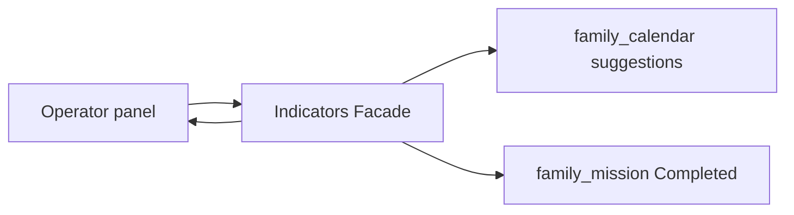

# TDD — Indicators panel

## Header & Metadata

| Field | Value |
|-------|-------|
| Tech lead | Bruno |
| Team | Great Kids |
| Epic | prototype high-fidelity |
| Status | Draft |
| Date | 2026-10-19 |
| Size | Small |

## Technical Solution

Operator panel reads live counts: scheduled (calendar suggestions `status = scheduled`), completed (`family_mission.status = Completed`), repeated (same `mission_id` completed more than once for a family). **No indicators table.** Empty dataset returns zeros, not an error splash. MVC, unidirectional: View → Route Handler → Service → Model. Reads after cycle/calendar writes; eventual read is allowed.

**GoF (required):**
- **Facade** — one read-model object runs the three queries so the panel does not instantiate calendar + mission workflows or know envelope internals. Clients may still query those hubs directly; the Facade only simplifies.

**Data flow:** 1) GET panel indicators (Operator/Admin). 2) Facade counts scheduled suggestion items across day envelopes. 3) Counts Completed rows. 4) Counts mission_ids with Completed count ≥ 2 (repeatable second cycle). 5) Missing data → `{ scheduled: 0, completed: 0, repeated: 0 }`.

**API**

| Method | Resource | Request | Response |
|--------|----------|---------|----------|
| GET | `/api/panel/indicators` | — | `{ "id", "scheduled": 0, "completed": 0, "repeated": 0 }` JSON object (not a fact-table row) |

**Persistence:** none new. Queries only `family_calendar` and `family_mission`. Scheduled count walks envelope items, not a child table. Migration: none.

## Context Pillars

### Descrição
> "Atividades agendadas, concluídas e repetidas, para medir o que a família realmente fez."

### Problema
Catalog size is not success. Staff need what families scheduled, finished, and repeated.

### Solução e trade-offs
Queries over `family_calendar` and `family_mission` — no extra fact table. Trade-off: computed indicators vs a warehouse; prototype is live SQL.

### Exemplo / contexto
`great-kids-funcionalidades.md` Painel de indicadores. Schema note: indicators are queries.

## Context

The Operator panel is a normal web layout (no phone chrome). Calendar and cycle already persist the facts. Staff must not confuse a large catalog with family follow-through.

Stakeholders: Operator/Admin, calendar and cycle writers. Parent does not own this surface.

## Problem Statement & Motivation

If staff only see catalog size, they cannot tell whether families scheduled or finished anything. Treating two completes of a repeatable mission as unique-only hides rhythm.

If skipped, the prototype cannot demo “what families actually did.” Why now: calendar scheduled status and Completed rows exist.

## Scope

### In Scope (V1)
- GET scheduled / completed / repeated as live queries
- Empty dataset → zeros
- Repeatable completed twice counts as repeated

### Out of Scope (V1)
- Indicators / facts warehouse table
- Historical snapshots / cubes
- Parent-facing dashboard of the same metrics

### Future (V2+)
- Per-family drill-down
- Time-window filters
- Materialized snapshot if live SQL slows

## Risks

| Risk | Impact | Probability | Mitigation |
|------|--------|-------------|------------|
| Empty set looks like failure | M | H | Zeros, HTTP 200 |
| New table invented | M | M | Facade queries only existing hubs |
| Repeated counted as unique-only | H | M | ≥2 Completed same mission_id |

## Implementation Plan

Each phase starts Red (failing Vitest) then Green (minimal pass), then refactor.

| Phase | Task | TDD cycle | Owner | Estimate |
|-------|------|-----------|-------|----------|
| 1 | Facade completed count | Red: mismatch vs Completed rows → Green: match | Great Kids | 0.5d |
| 2 | Facade scheduled count | Red: ignore envelope status → Green: scheduled items | Great Kids | 0.5d |
| 3 | Repeated + empty zeros | Red: error splash / unique-only → Green: zeros + repeats | Great Kids | 0.25d |

## Testing Strategy

| Type | Scope | Approach |
|------|-------|----------|
| Unit (Vitest) | Facade | zeros; repeat ≥2 |
| Integration (Vitest) | GET | completed = rows; scheduled = envelope items |
| Contract | JSON | object with three counts; no table required |

Critical: completed matches Completed rows; scheduled matches calendar `scheduled`; no indicators table.
