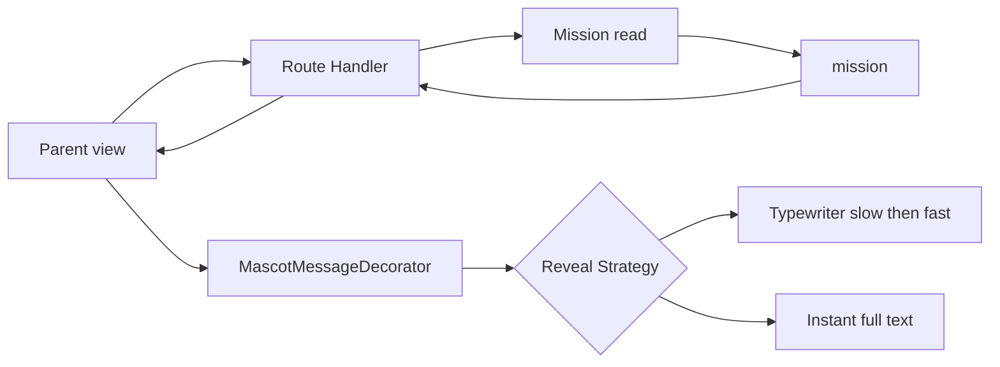

# TDD — Mascot mission message

## Header & Metadata

| Field | Value |
|-------|-------|
| Tech lead | Bruno |
| Team | Great Kids |
| Epic | prototype high-fidelity |
| Status | Draft |
| Date | 2026-10-19 |
| Size | Small |

## Technical Solution

Parent view presents a **published** mission payload already returned by pick, calendar, or cycle. No mascot resource and no extra table. MVC, unidirectional: View → Route Handler → Service → Model; the view never persists. Unpublished catalog rows never enter this surface (INV-001, INV-005).

**GoF (both, required):**
- **Strategy** — swap the reveal algorithm without changing the “show published copy” rule: typewriter vs reduced-motion instant text.
- **Decorator** — wrap the existing mission object with mascot message chrome (bubble, voice) without modifying the catalog row.

**Data flow:** 1) Handler returns a published mission JSON. 2) Decorator wraps title/description as a mascot message. 3) Strategy chooses typewriter or instant from prefers-reduced-motion. 4) Empty title/description: no typewriter; explicit empty. 5) Draft/in_review ids are rejected upstream.

**API:** presentation only. Consumes the mission object already returned (not a new envelope array).

| Method | Resource | Request | Response |
|--------|----------|---------|----------|
| existing family mission read | published mission | — | `{ "id", "title", "description", "review_status": "published" }` |

**Persistence / migration:** none. Soft familial colors on the family design system. JS typewriter library allowed.

## Context Pillars

### Descrição
> "as missões tem que ser entregues como se fosse a mensagem de texto de um mascote, pode usar biblioteca js para fazer o texto ser escrito digitando lento e depois rapido."

### Problema
A static activity card feels like a content dump. The product voice is someone talking to the family.

### Solução e trade-offs
Render the chosen mission as a mascot text message with a typewriter (slow then fast). JS library allowed. Trade-off: extra motion vs instant full text; must stay readable for conservative parents (soft colors, `/amaterasu-paint`).

### Exemplo / contexto
`prototype.md`. Idea book voice: “The entire product should feel like someone smart, funny and culturally aware is on the other side.”

## Context

The high-fidelity prototype serves the family app inside phone chrome and the Operator panel from the same process. Missions already exist as catalog rows with review_status; the Parent surface must not look like an admin card dump.

Stakeholders: Parent (commissioner click-through), family UI (motion and chrome), API (payload stays published-only). Product voice is a culturally aware counterpart, not a CMS list.

## Problem Statement & Motivation

Without mascot delivery, the prototype reads as a catalog, so the commissioner cannot judge the intended relationship with the family. Conservative parents bounce if motion hides copy or contrast is harsh.

If skipped, surprise, weekly suggestion, and cycle all land as static cards, so later features inherit the wrong voice. Why now: Parent shell is the delivery frame for every published mission.

## Scope

### In Scope (V1)
- Mascot chrome around an already-returned published mission
- Typewriter slow-then-fast; instant text when prefers-reduced-motion
- Explicit empty when title/description are blank (no typewriter on blank)

### Out of Scope (V1)
- New mascot HTTP resource or table
- Invented copy when the catalog is empty
- Native speech, TTS, or push

### Future (V2+)
- Per-family mascot persona variants
- Voice playback
- Operator preview of mascot chrome in the panel

## Risks

| Risk | Impact | Probability | Mitigation |
|------|--------|-------------|------------|
| Typewriter hides copy for reduced-motion users | H | M | Strategy must short-circuit to full text |
| Unpublished mission rendered in chrome | H | L | Reject non-published ids before decorate |
| Motion feels noisy to conservative parents | M | M | Soft colors; readable type; empty-state without animation |

## Implementation Plan

Each phase starts Red (failing Vitest) then Green (minimal pass), then refactor.

| Phase | Task | TDD cycle | Owner | Estimate |
|-------|------|-----------|-------|----------|
| 1 | Decorator wraps published mission as message | Red: unpublished/empty fail → Green: chrome | Great Kids | 0.5d |
| 2 | Strategy typewriter vs instant | Red: reduced-motion still types → Green: swap | Great Kids | 0.5d |
| 3 | Parent presentation of existing payload | Red: card dump still shown → Green: mascot only | Great Kids | 0.5d |

## Testing Strategy

| Type | Scope | Approach |
|------|-------|----------|
| Unit (Vitest) | Strategy + Decorator | Empty copy, reduced-motion, published-only |
| Integration (Vitest) | Handler payload | Unpublished never reaches presentation |
| UI | Phone chrome | Pittore verifies typewriter in the browser |

Critical: blank title/description; prefers-reduced-motion; unpublished never in mascot.
