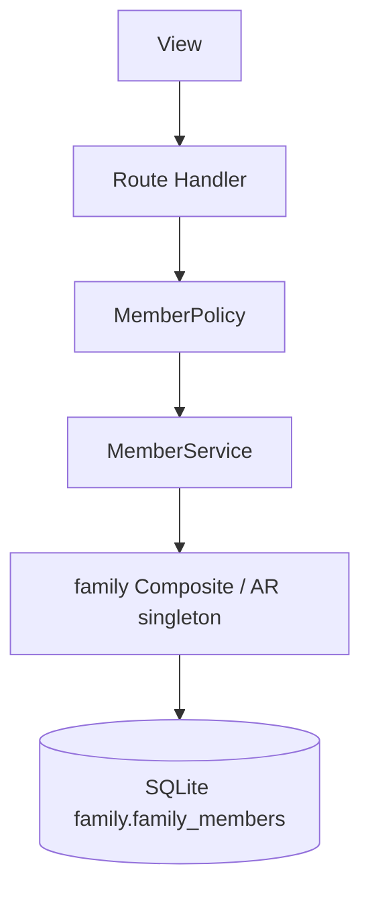

# TDD — Members without app access

## Header & Metadata

| Field | Value |
|-------|-------|
| Tech lead | Bruno |
| Team | Great Kids |
| Epic | prototype high-fidelity |
| Status | Draft |
| Date | 2026-10-19 |
| Size | Small |
| Harness | docs/harness/features/feature-members-without-app.md |

## Technical Solution

MVC: Route Handler is the controller. Family document is a Composite: `family` hub plus `family_members` envelope `{id, members:[{user_id, user_nickname, user_role}]}`. Members without app (children, grandparents) live only in that JSON — no `auth_user_id` login. Child context remains a view (context-switch), not a member login. Unidirectional: View → Route Handler → Policy → Service → family Active Record singleton → SQLite.

**Composite:** family document — hub row plus members list; replace whole envelope on PUT, never a bare array. **Policy:** titular (or Admin) writes members; reject photo fields; reject Child role combined with `auth_user_id` as a real login; INV-002.

Data flow: (1) Titular PUTs envelope. (2) Handler requires `{id, members:[]}`. (3) Policy rejects photo and child-login. (4) Service replaces `family_members`. (5) No `app_user` insert required for a child member. (6) JSON returns envelope.

| Method | Path | Request | Response |
|--------|------|---------|----------|
| PUT | /api/families/{id}/members | `{"id":"<env>","members":[{"user_id":null,"user_nickname":"Leo","user_role":"Child"}]}` | `200 {"id":"<env>","members":[{"user_id":null,"user_nickname":"Leo","user_role":"Child"}]}` |

Photo field present → 400. Child + auth login → 400. Bare array body → 400 (INV-004). Non-titular → 403.

**Schema (existing):** `family.family_members` TEXT JSON envelope. Member object today: user_id, user_nickname, user_role. No photo column. `app_user` if a row exists: name allowed, nick_name required, auth_user_id nullable. Relation, age band, interests are not in the envelope yet.

**Migration:** Wave 0 applies the full SQLite schema. This feature uses existing tables.

## Context Pillars

### Descrição
"Cadastro de filhos, avós e outros familiares que não acessam o app. Sugestão de campos: relação, idade ou faixa etária e interesses, para melhorar as recomendações."

### Problema
Recommendations need who is in the family without giving children (or grandparents) an account.

### Solução e trade-offs
Members live in `family.family_members` JSON. Schema today: user_id, user_nickname, user_role. User: real name allowed; no photo. Trade-off documented in `schema.md`: relation, age band, interests are not in the envelope yet — JSON-only, no FK. Child context is a view (feature-context-switch), not a login.

### Exemplo / contexto
`schema.md` Limitação de family_members. Apresentação: criança nunca é conta/perfil/foto.

## Context

Recommendations (later) need household composition. Product rule: a child is never an account, never a profile, never a photo. The study schema stores members as JSON without FK to `app_user`, which fits “no app access” but omits relation, age band, and interests asked in funcionalidades.

Titular maintains the list. Grandparents follow the same envelope. Stakeholders: titular, commissioner, Bruno, Scultore (envelope writes), Pittore (member UI without avatars).

## Problem Statement & Motivation

If children are created as `app_user` logins, INV-002 is broken and the prototype teaches the wrong product. If photo upload is accepted, the stack stores images the presentation forbids — legal and brand risk. If the API accepts a bare members array, INV-004 fails and every reader of the hub JSON breaks.

## Scope

**In Scope (V1):** PUT envelope `{id, members:[]}`; child/grandparent without auth_user_id; reject photo; nick_name required on app_user if a row exists; real name allowed; Policy titular/Admin.

**Out of Scope:** relation, age band, interests columns; child photos; child login; FK from JSON user_id to app_user; MinIO avatars.

**Future:** enrich envelope or table with relation, age band, interests; recommendation filters.

## Risks

| Risk | Impact | Prob. | Mitigation |
|------|--------|-------|------------|
| Photo smuggled in JSON | H | M | MemberPolicy rejects any image/photo key |
| Child login via auth_user_id | H | L | Reject Child + auth_user_id as login |
| Bare array envelope | M | M | INV-004 shape check on write |

## Implementation Plan

| Phase | Task | TDD cycle | Owner | Estimate |
|-------|------|-----------|-------|----------|
| 1 | MemberPolicy + INV-002 | Red: photo and child-login fail → Green: Policy | Bruno | 0.5d |
| 2 | Composite envelope write | Red: `{id, members:[]}` required; no photo field → Green: family AR | Bruno | 0.5d |
| 3 | PUT /api/families/{id}/members | Red: integration 200/400/403 → Green: Route Handler | Bruno | 0.5d |

## Testing Strategy

| Type | Scope | Approach |
|------|-------|----------|
| Unit (Vitest) | Policy, envelope | No photo; envelope shape; child without auth login |
| Integration (Vitest) | PUT members | Replace list; 403 non-titular |
| Frontend | — | No unit tests. Pittore browser: member list, no child avatar |

**Critical (aceite):** child member has no photo field; name allowed; nick_name required on app_user if a row exists; envelope `{id, members:[...]}`.

## Security Considerations

Mock session; roles Admin/Operator/Parent/Child. Child is not an account; no child photos; real name allowed; nick_name required if `app_user` exists. No auth tables; no `.env` writes. Members JSON is PII (nicknames) — do not log. Titular/Admin only on PUT.
