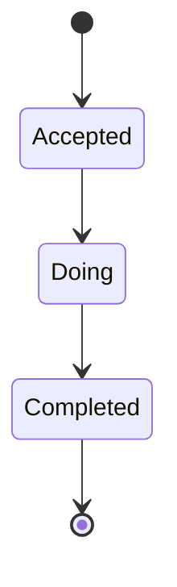

# TDD — Mission cycle

## Header & Metadata

| Field | Value |
|-------|-------|
| Tech lead | Bruno |
| Team | Great Kids |
| Epic | prototype high-fidelity |
| Status | Draft |
| Date | 2026-10-19 |
| Size | Small |

## Technical Solution

A `family_mission` moves `Accepted` → `Doing` → `Completed`. Closing `{ do_again, save_memory }` is stored only on complete, in the same transaction as status (INV-003). No unique `(fam_id, mission_id)` — a second cycle is a new row when `mission.repeatable`. Same-row jump `Completed` → `Accepted` is rejected. Mission must stay a **published** catalog id at accept (INV-001). MVC, unidirectional: View → Route Handler → Service → Model.

**GoF (both, required):**
- **State** — Accepted, Doing, Completed are state objects that own legal transitions via polymorphism, not a scattered if-chain. Completed refuses a return to Accepted on the same row.
- **Command** — StartDoing and CompleteMission encapsulate the writes; Complete requires closing and may allow or reject skip-from-Accepted (TBD service), but must not skip closing.

**Data flow:** 1) Row exists as Accepted (surprise Factory or equivalent). 2) PATCH status Doing. 3) PATCH status Completed + closing object (not an envelope array). 4) Illegal reverse transition → 422. 5) Repeatable: new row; non-repeatable: reject second cycle.

**API**

| Method | Resource | Request | Response |
|--------|----------|---------|----------|
| PATCH | `/api/family-missions/{id}` | `{ "status": "Doing" }` or `{ "status": "Completed", "closing": { "do_again", "save_memory" } }` | `{ "id", "fam_id", "mission_id", "status", "closing" }`; 422 illegal jump or missing closing |

**Persistence:** `family_mission.status` CHECK enum; `closing` JSON object `{ do_again, save_memory }`. Transaction: status + closing together. Title snapshot on the row at accept so history can survive later unpublish. Additive column if missing.

## Context Pillars

### Descrição
> "Aceitar, fazer e concluir, seguido de uma pergunta de fechamento: fariam de novo? Vale guardar na memória?"

### Problema
A suggestion that is never accepted, done, and closed cannot feed history, rhythms, or indicators.

### Solução e trade-offs
`family_mission` status Accepted | Doing | Completed; closing `{ do_again, save_memory }`. No unique (fam, mission) because repeatable. Trade-off: multiple rows per pair.

### Exemplo / contexto
`great-kids-funcionalidades.md` Ciclo da missão. Schema `family_mission`.

## Context

Surprise (and later calendar accept) starts a cycle. Completed is the source of history, `missions_completed`, diary mission notes, and panel indicators. Closing is a plain object, not `{ id, key: [] }`.

Stakeholders: Parent (accept/do/complete), completed-missions list, indicators, note-types.

## Problem Statement & Motivation

Without a closed cycle, the product cannot prove the family did anything: counters, memories, and panel queries would lie. Skipping closing on complete loses “do again / save memory.”

If skipped, V1 click-through dies after surprise. Why now: Accepted rows already exist.

## Scope

### In Scope (V1)
- Enum statuses only; closing required on Completed
- Reject Completed → Accepted on the same row
- Second cycle only when `repeatable` (new row)

### Out of Scope (V1)
- Unique `(fam_id, mission_id)`
- Auto-skip closing
- Staff-forced complete from the panel

### Future (V2+)
- Resolve TBD: complete from Accepted skipping Doing
- Concurrent complete locking
- Child-context complete rules

## Risks

| Risk | Impact | Probability | Mitigation |
|------|--------|-------------|------------|
| Complete without closing | H | M | Transaction: both or neither |
| Reverse status on same row | H | M | State object rejects |
| Repeatable blocked by unique pair | H | L | No unique on the pair |

## Implementation Plan

Each phase starts Red (failing Vitest) then Green (minimal pass), then refactor.

| Phase | Task | TDD cycle | Owner | Estimate |
|-------|------|-----------|-------|----------|
| 1 | State transitions | Red: Completed→Accepted ok → Green: 422 | Great Kids | 0.5d |
| 2 | Complete Command + closing | Red: status without closing → Green: txn | Great Kids | 0.5d |
| 3 | Repeatable new row | Red: second cycle on non-repeatable → Green: reject | Great Kids | 0.5d |

## Testing Strategy

| Type | Scope | Approach |
|------|-------|----------|
| Unit (Vitest) | State objects | legal vs illegal jumps |
| Integration (Vitest) | PATCH | closing written; enum only |
| Contract | JSON | closing object, not array envelope |

Critical: enum statuses; closing on complete; second cycle only if repeatable.
