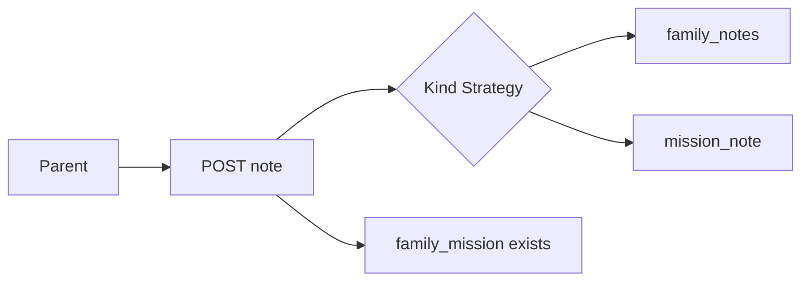

# TDD — Note types and mission link

## Header & Metadata

| Field | Value |
|-------|-------|
| Tech lead | Bruno |
| Team | Great Kids |
| Epic | prototype high-fidelity |
| Status | Draft |
| Date | 2026-10-19 |
| Size | Small |

## Technical Solution

Notes carry a `kind`: `phrase` \| `first_time` \| `funny` \| `learned` \| `family_fail`. Kinds are documented literals in JSON, not a database enum. `mission_note` envelope links `mission_id` / `family_mission_id` to a nested note. Unknown kind rejected in service. Link to a mission the family never had is rejected. MVC, unidirectional: View → Route Handler → Service → Model. Envelopes `{ id, notes: [] }` (INV-004). Text only; photos belong to diary rejection.

**GoF (required):**
- **Strategy** — each kind is an interchangeable validation/presentation algorithm behind one “append note” rule. Adding a kind does not rewrite the diary write; unknown kind has no Strategy and is rejected.

**Data flow:** 1) POST with `kind` + text. 2) Kind Strategy validates literal. 3) Diary note appends `family_notes`. 4) Mission memory appends `mission_note` with `mission_id`, `family_mission_id`, nested `{ id, text, kind }`. 5) Family must own that `family_mission` (typically Completed).

**API**

| Method | Resource | Request | Response |
|--------|----------|---------|----------|
| POST | `/api/families/{id}/diary` | `{ "kind", "text" }` or `{ "kind", "text", "mission_id", "family_mission_id" }` | `{ "id", "family_notes": { "id", "notes": [...] }, "mission_note": { "id", "notes": [{ "mission_id", "family_mission_id", "note": { "id", "text", "kind" } }] } }`; 422 unknown kind or foreign mission |

**Persistence:** `family_diary.family_notes` and `family_diary.mission_note`. No CHECK on kind (JSON). Service whitelist of five literals.

## Context Pillars

### Descrição
> "Ligar cada nota a uma missão ou atividade. Tipos: frase, primeira vez, momento engraçado, algo aprendido e Family Fail."

### Problema
A flat diary cannot tell a first time from a Family Fail or from a mission memory.

### Solução e trade-offs
Kinds: phrase, first_time, funny, learned, family_fail. `mission_note` envelope links mission_id / family_mission_id. Kinds documented, not DB enum (JSON). Trade-off: cannot CHECK kind without a trigger.

### Exemplo / contexto
`great-kids-funcionalidades.md` Vínculo e tipos de nota. Idea Book Family Fails / Memory Mile Markers.

## Context

The diary holds family text. Mission cycle produces rows memories can point at. Idea Book needs Firsts and Family Fails as typed memories, not a single blob.

Stakeholders: Parent (save memory), diary GET, completed missions.

## Problem Statement & Motivation

Untyped notes collapse a first step and a fail into one list, so the product cannot surface mile markers. A note linked to a mission the family never ran would invent history.

If skipped, diary is a generic notepad and closing `save_memory` has nowhere typed to go. Why now: cycle rows exist.

## Scope

### In Scope (V1)
- Five kinds accepted; invalid kind not stored
- `mission_note` holds `mission_id` and nested note
- Reject link to a mission the family never had

### Out of Scope (V1)
- Database ENUM / trigger on kind
- Photo or media kinds
- Operator-authored family notes

### Future (V2+)
- Kind-specific prompts
- CHECK/trigger on kind
- Curated material id on a note

## Risks

| Risk | Impact | Probability | Mitigation |
|------|--------|-------------|------------|
| Unknown kind persisted | H | M | Service whitelist |
| Orphan mission_id | H | M | Require family-owned family_mission |
| Bare notes array | H | L | Envelope `{ id, notes: [] }` |

## Implementation Plan

Each phase starts Red (failing Vitest) then Green (minimal pass), then refactor.

| Phase | Task | TDD cycle | Owner | Estimate |
|-------|------|-----------|-------|----------|
| 1 | Kind Strategy whitelist | Red: garbage kind stored → Green: 422 | Great Kids | 0.5d |
| 2 | mission_note envelope | Red: missing nested note → Green: shape | Great Kids | 0.5d |
| 3 | Family-owned mission link | Red: foreign id stored → Green: 422 | Great Kids | 0.25d |

## Testing Strategy

| Type | Scope | Approach |
|------|-------|----------|
| Unit (Vitest) | Strategy | five kinds; unknown reject |
| Integration (Vitest) | POST | mission_note shape; orphan reject |
| Contract | JSON | envelopes, nested note |

Critical: five kinds; mission_note holds mission_id + nested note; invalid kind not stored.
