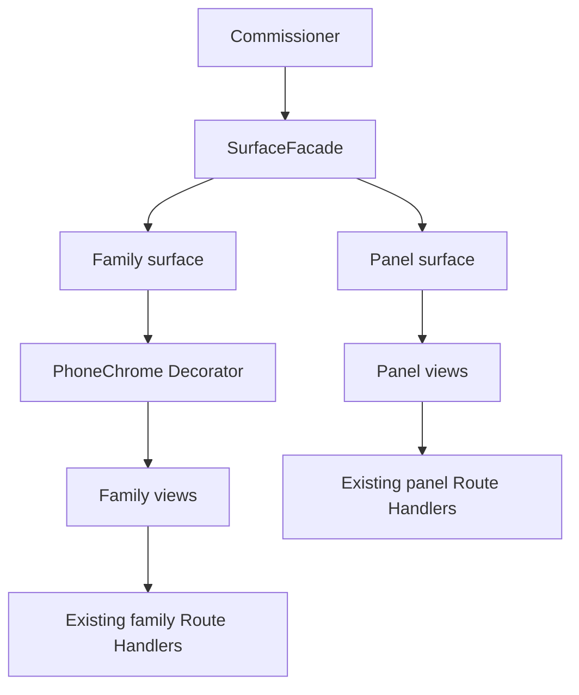

# TDD — Parent phone shell

## Header & Metadata

| Field | Value |
|-------|-------|
| Tech lead | Bruno |
| Team | Great Kids |
| Epic | prototype high-fidelity |
| Status | Draft |
| Date | 2026-10-19 |
| Size | Small |
| Harness | docs/harness/features/feature-parent-shell.md |

## Technical Solution

MVC: Route Handler remains the API controller for family data; this feature adds no extra API. Two surfaces share the process: family UI (Parent walkthrough, Child view via context-switch) and staff panel. Facade selects the surface. Decorator wraps only the family surface with iPhone 15 Pro Max chrome (tall, wide). No native mobile stack. Unidirectional: View (decorated or not) → existing family Route Handlers → Policy → Model → SQLite.

**Facade:** FamilyAppSurface vs PanelSurface — which chrome, nav, and mock role apply. **Decorator:** PhoneChrome around the family view only; panel must not receive chrome. Missing frame asset → do not render family UI as if it were the panel. Small viewport: frame stays; inner app scrolls.

Data flow: (1) URL targets family or panel surface. (2) Facade chooses surface. (3) Family: Decorator applies phone chrome, Parent mock (switchable). (4) Panel: web layout, Admin/Operator mock. (5) Views call existing APIs. (6) No new persistence.

| Method | Path | Request | Response |
|--------|------|---------|----------|
| — | (none added) | Family surface reuses `/api/app-users`, `/api/families`, `/api/session/context`. Panel reuses `/api/panel/*`. | — |

**Schema (existing):** none new. Reads `app_user` / `family` via sibling APIs.

**Migration:** Wave 0 applies the full SQLite schema. This feature uses existing tables.

## Context Pillars

### Descrição
"vamos emular o comportamento mobile atráves de uma tela html com uma imagem de celular (preferencia por um iphone 15 pro max com tela alta e mais larga) e permitir que ela navegue pela visão do que seria um usuário Parent"

### Problema
The commissioner needs a high-fidelity family app to click through without a native mobile build.

### Solução e trade-offs
HTML phone chrome (iPhone 15 Pro Max, tall and wide) around the Parent app. No React Native/Expo. Trade-off: pixel-true to a frame, not a device OS (gestures, notifications, install).

### Exemplo / contexto
`my_docs/prototype.md` — high-fidelity prototype for the commissioner; Parent navigation in an emulated phone.

## Context

The commissioner evaluates the family product on the web. Native iOS/Android is out of scope. An HTML phone frame (iPhone 15 Pro Max, tall and wide) is the contract for “this is the app.” Staff configuration stays a normal web panel.

Parent navigation runs inside the frame; context-switch can show Child views in the same chrome. Stakeholders: commissioner, Pittore (chrome and family UI), Bruno, Scultore (no extra API).

## Problem Statement & Motivation

Without chrome, family screens look like the admin panel — the prototype fails its high-fidelity brief. If panel routes reuse the phone frame, staff work becomes unusable and surfaces leak. A native package in dependencies would contradict the harness (no RN/Expo) and block a simple web deploy.

## Scope

**In Scope (V1):** Family surface inside iPhone 15 Pro Max HTML chrome; Parent navigation; panel surface without chrome; Facade+Decorator; no native mobile package; small viewport keeps frame and inner scroll.

**Out of Scope:** Native apps, OS gestures, push notifications, PWA install; Flowbite as dependency; new REST endpoints.

**Future:** Device presets; notch-safe layout; optional desktop family without frame (explicit product decision).

## Risks

| Risk | Impact | Prob. | Mitigation |
|------|--------|-------|------------|
| Panel inherits phone chrome | H | M | Facade: panel surface never decorated |
| Missing frame asset unframes app | M | M | Fallback still marked family surface, not panel |
| Native kit added | H | L | Forbidden native stacks; aceite: no native package |

## Implementation Plan

| Phase | Task | TDD cycle | Owner | Estimate |
|-------|------|-----------|-------|----------|
| 1 | Surface isolation Policy | Red: Parent mock must not serve panel role → Green: Policy | Bruno | 0.5d |
| 2 | No extra Route Handlers | Red: only sibling family/session APIs exist → Green: reuse contracts | Bruno | 0.25d |
| 3 | Facade + Decorator composition | Red: family surface Parent default still holds → Green: compose surfaces | Bruno | 0.5d |

Pittore verifies chrome in the browser after Green. No trailing “write tests” phase.

## Testing Strategy

| Type | Scope | Approach |
|------|-------|----------|
| Unit (Vitest) | Surface Policy | Parent mock ≠ panel Admin/Operator; Child still a view |
| Integration (Vitest) | Existing APIs | No new paths; Parent default session unchanged |
| Frontend | Pittore browser | No UI unit tests. Chrome on family; none on panel; no native package |

**Critical (aceite):** family routes render inside iPhone 15 Pro Max chrome; panel routes do not use phone chrome; no native mobile package in dependencies.

## Security Considerations

Mock session Parent on family surface; Child is a view. Panel Admin/Operator must not use family chrome or Parent session. No extra API → no new PII endpoints. No child photos; real name allowed in family data already stored. No `.env` writes; no auth tables. Do not treat the frame as an origin for weaker Policy.
