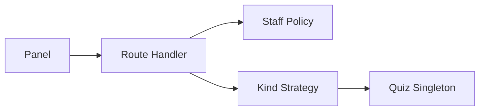

# TDD: Question bank

## 1. Header & Metadata

| Field | Value |
|-------|-------|
| Tech lead | Bruno |
| Team | Great Kids |
| Epic | prototype high-fidelity |
| Status | Draft |
| Date | 2026-10-19 |
| Size | Small |

## 2. Technical Solution

Staff maintain quiz and Say What? questions in one table. Family quiz reads active, not-deleted rows; it never invents question text. Parent cannot CRUD the bank. No ORM. List responses use `{ id, questions: [] }`.

**Patterns (all required):** Singleton Active Record for `family_quiz`. Strategy selects by `kind` Family-Quiz vs Say-What for offer and panel filters.

**Security note:** bank writes are panel-only. Deleted rows stay out of family quiz. Question text may later join PII answers; do not log raw answers here.

**Wave 0 owns DDL** for `family_quiz`. This feature does not add tables.

**Schema:** `family_quiz` (id, question_text NOT NULL, status active|inactive, weight ≥ 0, kind Family-Quiz|Say-What, deleted 0|1, timestamps). Partial index on live (deleted = 0).

| Method | Path | Auth | Request | Response |
|--------|------|------|---------|----------|
| GET | /api/panel/questions | Staff | optional kind | `{ id, questions: [{ id, question_text, kind, status, weight, deleted }] }` |
| POST | /api/panel/questions | Staff | `{ question_text, kind, weight, status }` | `{ id, question: { … } }` |
| GET | /api/panel/questions/{id} | Staff | — | `{ id, question: { … } }` |
| PATCH | /api/panel/questions/{id} | Staff | same fields | `{ id, question: { … } }` |
| DELETE | /api/panel/questions/{id} | Staff | — | `{ id, question: { deleted: true } }` |

Errors: empty question_text reject; invalid kind reject; Parent CRUD → 403. Soft delete; family quiz excludes deleted.

## 3. Context Pillars

**How do you describe the feature?**
"Perguntas do quiz da família e perguntas Say What?"

**What problem does it objectively solve?**
Quiz and Say What? need a maintained list of questions, not free-form invention at runtime.

**What is the expected solution? What trade-offs does it involve?**
`family_quiz` rows with `kind` Family-Quiz | Say-What, weight, status, deleted. Trade-off: one table for both kinds vs two tables.

**What example or context do we have of the problem and the solution?**
`great-kids-funcionalidades.md` Banco de perguntas. Schema `family_quiz`.

## 4. Context

Family GPS and Say What? missions need staff-written prompts. The study schema stores both kinds on `family_quiz`. The panel is the only write surface.

Family quiz (later) answers into the profile envelope. This TDD stops at bank CRUD and kind filtering.

## 5. Problem Statement & Motivation

Runtime-invented questions cannot be reviewed and will not match stored `question_id`s. Empty text and mixed kinds without Strategy break offer lists. If Parents can CRUD the bank, the catalog is no longer staff-owned. Cost of delay: family quiz and profile have no questions to answer.

## 6. Scope

**In scope (V1):** staff CRUD on panel questions; kind enum; soft delete; Parent cannot CRUD; family offer excludes deleted.

**Out of scope:** family answering; profile write-back; inventing questions; two tables.

**Future:** i18n; question versions; weight-based sampling UI.

## 7. Risks

| Risk | Impact | Probability | Mitigation |
|------|--------|-------------|------------|
| Parent CRUD on bank | H | L | Staff Policy; 403 |
| Deleted question offered | H | M | Live index + query deleted = 0 |
| Empty question_text | M | M | NOT NULL + handler reject |

## 8. Implementation Plan

Each phase is Red (failing Vitest) then Green (minimal code), then refactor.

| Phase | Task | TDD cycle | Owner | Estimate |
|-------|------|-----------|-------|----------|
| 1 – Model | Singleton + kind | Red: kind enum and empty text fail → Green: Singleton | Scultore | 0.5d |
| 2 – CRUD | Panel handlers | Red: Parent 403 fail → Green: Policy + CRUD | Scultore | 0.5d |
| 3 – Offer filter | Strategy by kind | Red: deleted included → Green: live + kind Strategy | Scultore | 0.25d |

## 9. Testing Strategy

| Type | Scope | Approach |
|------|-------|----------|
| Unit | Strategy, validations | Vitest: kind, empty text, deleted excluded |
| Integration | Panel CRUD | Vitest: envelope; Parent cannot CRUD |

Critical: kind enum enforced; deleted questions excluded from family quiz; Parent cannot CRUD the bank.
