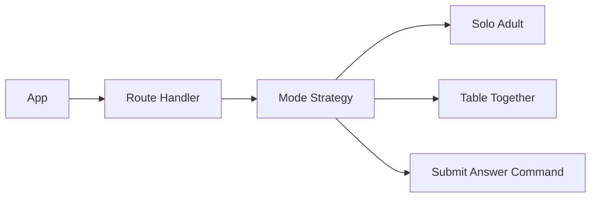

# TDD: Quiz answer modes

## 1. Header & Metadata

| Field | Value |
|-------|-------|
| Tech lead | Bruno |
| Team | Great Kids |
| Epic | prototype high-fidelity |
| Status | Draft |
| Date | 2026-10-19 |
| Size | Small |

## 2. Technical Solution

Same family quiz POST, plus a request `mode` of `solo` (one adult) or `table` (family together). Storage stays `family_profile.quiz_answer`. Mode is not a new table or column; persist on the write payload and optionally `profile_notes` until a column exists. Missing mode defaults to solo. No ORM. Envelope JSON.

**Patterns (all required):** Strategy selects solo vs table UX/validation around the same Command write.

**Security note:** Child context may answer; it cannot edit the question bank. Answers remain PII — do not log mode plus raw text together. Unpublished missions stay panel-only on other APIs.

**Wave 0 owns DDL.** This feature adds no table and no mode column.

**Schema:** unchanged `quiz_answer` `{ id, answers: [{ question_id, answer_text, deleted }] }`. Mode lives on the request (`solo`|`table`). Optional note in `profile_notes` is free text, not a second answers array.

| Method | Path | Auth | Request | Response |
|--------|------|------|---------|----------|
| POST | /api/families/{id}/quiz | Parent of family | `{ question_id, answer_text, mode }` | `{ id, answers: [{ question_id, answer_text, deleted }] }` |

`mode`: `solo` | `table`. Omit → `solo`. Both modes persist one answer in the same envelope. No second table.

Errors: invalid mode reject (after defaulting only when missing). Child cannot CRUD `/api/panel/questions`.

## 3. Context Pillars

**How do you describe the feature?**
"Um adulto responde sozinho, ou a família responde junta, à mesa."

**What problem does it objectively solve?**
Sometimes one Parent answers; sometimes the family is at the table together. The quiz must support both.

**What is the expected solution? What trade-offs does it involve?**
Mode is a request flag on submit (solo adult vs together). Same storage. Trade-off: mode not a DB column in the study schema — keep on the write payload / profile_notes until a column exists.

**What example or context do we have of the problem and the solution?**
`great-kids-funcionalidades.md` Modos de resposta.

## 4. Context

The playful quiz is used either by one Parent or around the table. Product copy differs; the stored fact is the same answer used by GPS and pick.

Child context is a view, not an account (INV-002). Bank edits stay staff-only.

## 5. Problem Statement & Motivation

A single implied “adult types” flow fails table play. A second table for mode would fork answers from the profile envelope. Missing mode must still save (default solo) so the GPS is not blocked. Cost of delay: table sessions drop answers or invent a parallel store.

## 6. Scope

**In scope (V1):** `mode` solo|table on the existing POST; default solo; both persist one envelope answer; Child cannot edit the bank.

**Out of scope:** new table; mode column; inventing questions; bank CRUD by family.

**Future:** mode column; table lock; per-member attributions.

## 7. Risks

| Risk | Impact | Probability | Mitigation |
|------|--------|-------------|------------|
| Mode creates a second store | H | M | Same Command and envelope |
| Missing mode drops the write | M | M | Default solo |
| Child edits the bank | H | L | Staff Policy on panel questions |

## 8. Implementation Plan

Each phase is Red (failing Vitest) then Green (minimal code), then refactor.

| Phase | Task | TDD cycle | Owner | Estimate |
|-------|------|-----------|-------|----------|
| 1 – Strategy | solo vs table | Red: missing mode fails save → Green: default solo | Scultore | 0.25d |
| 2 – Persist | Same POST | Red: table mode writes a new table → Green: one envelope | Scultore | 0.5d |
| 3 – Policy | Child vs bank | Red: Child PATCH panel question succeeds → Green: 403 | Scultore | 0.25d |

## 9. Testing Strategy

| Type | Scope | Approach |
|------|-------|----------|
| Unit | Mode Strategy | Vitest: solo, table, default, invalid mode |
| Integration | Same POST | Vitest: both modes persist; no second table; Child cannot edit bank |

Critical: both modes persist an answer; mode does not create a second table; Child context cannot edit the question bank.
