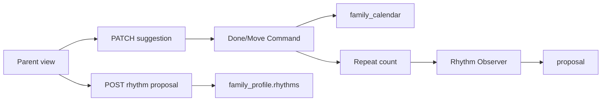

# TDD — Reminders and follow-up

## Header & Metadata

| Field | Value |
|-------|-------|
| Tech lead | Bruno |
| Team | Great Kids |
| Epic | prototype high-fidelity |
| Status | Draft |
| Date | 2026-10-19 |
| Size | Small |

## Technical Solution

Update a calendar suggestion to `done` or `moved`. After four repeats of the same published mission, propose a rhythm envelope item on `family_profile.rhythms` — write only if the Parent accepts. Notifications stay a boolean on the day row (no push provider). MVC, unidirectional: View → Route Handler → Service → Model. Observer must not call back into the calendar writer (no cycle).

**GoF (both, required):**
- **Command** — MarkDone and MoveDay encapsulate status writes; Move merges into the target day’s suggestions instead of duplicating the calendar unique key.
- **Observer** — repeat count notifies a rhythm-proposal observer in one direction. Dismissed proposal does not write `rhythms`.

**Data flow:** 1) PATCH sets `done` or `moved`. 2) Move merges into existing target day; no second `(family_id, day)` row. 3) After write, count completed/moved repeats of `mission_id`. 4) At four, Observer emits a proposal (not an auto-insert). 5) POST proposal appends `{ id, label, source_mission_id, weekday }` inside `{ id, rhythms: [] }` only on accept.

**API**

| Method | Resource | Request | Response |
|--------|----------|---------|----------|
| PATCH | `/api/families/{id}/calendar/{day}/suggestions/{sid}` | `{ "status": "done" \| "moved", "target_day"? }` | updated day envelope(s); `target_day` required when moved |
| POST | `/api/families/{id}/rhythms/proposal` | `{ "source_mission_id", "label", "weekday" }` or `{ "dismissed": true }` | rhythms envelope on accept; unchanged on dismiss |

**Persistence:** `family_calendar.suggestions` statuses; `family_profile.rhythms` envelope (INV-004). No push table. Additive only.

## Context Pillars

### Descrição
> "Lembretes, marcar como feita e mover de dia. Quando algo se repete, o app propõe transformar em ritmo (por exemplo, depois de quatro vezes)."

### Problema
Scheduled things rot unless they can be done, moved, or turned into a rhythm.

### Solução e trade-offs
Update suggestion status done/moved; after four repeats, propose a rhythm JSON on profile. Trade-off: notifications bool on the day row, not a push provider in this prototype.

### Exemplo / contexto
`great-kids-funcionalidades.md` Lembretes. Idea Book Family Rhythms.

## Context

Calendar already holds scheduled suggestions. Profile already has a rhythms envelope. The prototype must show follow-through without a notification vendor. Four repeats is the product threshold for “this is becoming a rhythm.”

Stakeholders: Parent (done/move/accept proposal), profile owners, indicators (scheduled vs done).

## Problem Statement & Motivation

A calendar that cannot mark done or move becomes stale, so the week no longer matches family life. Without a four-repeat prompt, rhythms stay empty and the compass never learns habits.

If skipped, indicators under-count follow-through and profile rhythms never fill. Why now: day uniqueness and envelopes exist.

## Scope

### In Scope (V1)
- Persist `done` and `moved`
- Merge move into existing target day (no duplicate PK)
- Four-repeat rhythm proposal; dismiss does not write

### Out of Scope (V1)
- External push / email provider
- Auto-insert rhythm without accept
- Recurring calendar materialization

### Future (V2+)
- Push provider behind the day notifications flag
- Auto-schedule from accepted rhythms
- Undo move

## Risks

| Risk | Impact | Probability | Mitigation |
|------|--------|-------------|------------|
| Move duplicates calendar PK | H | M | Merge into target suggestions |
| Observer writes rhythms on dismiss | M | M | POST dismiss is a no-write |
| Observer loops into calendar | H | L | Unidirectional notify only |

## Implementation Plan

Each phase starts Red (failing Vitest) then Green (minimal pass), then refactor.

| Phase | Task | TDD cycle | Owner | Estimate |
|-------|------|-----------|-------|----------|
| 1 | Done/Move Commands | Red: status ignored → Green: persist | Great Kids | 0.5d |
| 2 | Move merge unique | Red: second day row → Green: merge | Great Kids | 0.5d |
| 3 | Observer four-repeat proposal | Red: auto-write / no prompt → Green: propose only | Great Kids | 0.5d |

## Testing Strategy

| Type | Scope | Approach |
|------|-------|----------|
| Unit (Vitest) | Commands + Observer | done/moved; four count; dismiss |
| Integration (Vitest) | PATCH + POST | merge PK; envelope append |
| Contract | JSON | rhythms `{ id, rhythms: [] }` |

Critical: statuses persist; four repeats can add a rhythm item; no external push required.
