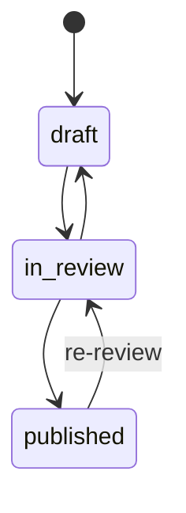

# TDD: Activity review flow

## 1. Header & Metadata

| Field | Value |
|-------|-------|
| Tech lead | Bruno |
| Team | Great Kids |
| Epic | prototype high-fidelity |
| Status | Draft |
| Date | 2026-10-19 |
| Size | Small |

## 2. Technical Solution

Staff move a mission through draft → in_review → published. Re-review of a published row leaves published (unpublish) so family lists drop it until published again. Family pick/list never invent a mission (INV-001) and never return draft or in_review (INV-005). No ORM. Wave 0 already has `review_status`.

**Patterns (all required):** State owns legal `review_status` transitions. Policy: Staff may review; Parent/Child never publish; family surfaces only published + active + not deleted.

**Security note:** unpublished missions are panel-only. Family APIs on unpublished id return empty/error and never invent catalog copy.

**Wave 0 owns DDL** for `mission.review_status` (draft|in_review|published) and the partial index on published + active + not deleted. This feature does not add tables.

**Schema:** `review_status` TEXT CHECK those three literals. Partial index on published/active/not-deleted. Re-review sets in_review (family list omits it). Optional material Need-update is a flag on `mission_material`, not a new status.

| Method | Path | Auth | Request | Response |
|--------|------|------|---------|----------|
| POST | /api/missions/{id}/review | Staff | `{ review_status }` | `{ id, mission: { id, review_status } }` |

Errors: illegal transition reject; missing id reject; family pick of unpublished → empty/error, never a generated mission.

## 3. Context Pillars

**How do you describe the feature?**
"Rascunho, revisão e publicado. Possibilidade de reavaliar uma atividade já aprovada (por exemplo, quando o conteúdo muda)."

**What problem does it objectively solve?**
Unreviewed copy must not reach a family. Content can change after publish and must be re-checked.

**What is the expected solution? What trade-offs does it involve?**
`review_status`: draft | in_review | published. Family pick/list only published. Trade-off: re-review unpublishes or flags Need-update on materials; family may briefly lose an activity.

**What example or context do we have of the problem and the solution?**
`great-kids-funcionalidades.md` Fluxo de revisão. INV-001 / INV-005.

## 4. Context

The panel can draft rich fiches. The family app and any pick/suggest path must only use staff-approved rows. When copy changes after publish, staff must pull the row back from family surfaces.

Stakeholders: Operator/Admin review; Parent only sees published; pick rules consume the same published set.

## 5. Problem Statement & Motivation

If drafts leak, families receive unvetted missions (INV-005). If re-review keeps the row published, changed copy stays live. If pick invents a mission when none is published, INV-001 fails. Cost of delay: family pick and surprise/weekly flows cannot be safely wired.

## 6. Scope

**In scope (V1):** State transitions; Staff POST review; family APIs omit draft/in_review; re-review hides from family; pick never returns non-published.

**Out of scope:** multi-approver workflow; scheduled publish; family preview of drafts; inventing missions.

**Future:** review comments; audit trail; Need-update batch.

## 7. Risks

| Risk | Impact | Probability | Mitigation |
|------|--------|-------------|------------|
| Family API lists in_review | H | M | Policy + published filter on every family read |
| Pick invents a mission | H | L | INV-001: catalog id only; empty/error if none |
| Re-review leaves row published | H | M | State: published → in_review |

## 8. Implementation Plan

Each phase is Red (failing Vitest) then Green (minimal code), then refactor.

| Phase | Task | TDD cycle | Owner | Estimate |
|-------|------|-----------|-------|----------|
| 1 – State | Transitions | Red: illegal transition fails → Green: State machine | Scultore | 0.5d |
| 2 – Review API | POST /api/missions/{id}/review | Red: Parent 403 and publish persist fail → Green: Policy + handler | Scultore | 0.5d |
| 3 – Family filter | Published-only reads | Red: draft appears on family list → Green: filter + INV tests | Scultore | 0.5d |

## 9. Testing Strategy

| Type | Scope | Approach |
|------|-------|----------|
| Unit | State, Policy | Vitest: legal/illegal transitions, role matrix |
| Integration | Review POST + family list | Vitest: publish then unpublish hides; family omits draft/in_review |

Critical: family API omits draft and in_review; publish then unpublish hides; AI/pick never returns non-published.
