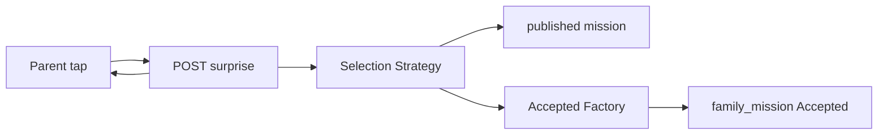

# TDD — Surprise mission

## Header & Metadata

| Field | Value |
|-------|-------|
| Tech lead | Bruno |
| Team | Great Kids |
| Epic | prototype high-fidelity |
| Status | Draft |
| Date | 2026-10-19 |
| Size | Small |

## Technical Solution

One Parent tap returns one **published** + active + not-deleted catalog mission (INV-001, INV-005). Copy may say “IA”; implementation is selection among catalog rows, never generated title/description. Empty catalog → explicit empty. MVC, unidirectional: View → Route Handler → Service → Model. Presentation is the mascot payload (no extra mascot API).

**GoF (both, required):**
- **Strategy** — interchangeable selection (profile, ages, history skip unless repeatable, context) without changing “return a catalog id or empty.”
- **Factory** — creates `family_mission` in `Accepted` from the chosen published id; does not invent a mission object.

**Data flow:** 1) POST surprise. 2) Strategy ranks only published rows. 3) If none (or history exhausted and none repeatable), empty — do not reuse unpublished. 4) Factory inserts `family_mission` status `Accepted`. 5) Response is that mission payload for mascot chrome.

**API**

| Method | Resource | Request | Response |
|--------|----------|---------|----------|
| POST | `/api/families/{id}/missions/surprise` | `{ }` | `{ "id", "mission_id", "status": "Accepted", "title", "description", "review_status": "published" }` or empty `{ "id", "mission_id": null }` with explicit empty; never fabricated copy |

**Persistence:** insert `family_mission` (`fam_id`, `mission_id`, `status=Accepted`). No unique `(fam_id, mission_id)` — repeatable cycles are later rows. Migration: additive inserts only.

## Context Pillars

### Descrição
> "Um clique e a família descobre a missão do momento. A missão é escolhida pela IA a partir da biblioteca, considerando as características e os gostos da família."

### Problema
Parents stall in choice. They need one trusted next thing, not a feed.

### Solução e trade-offs
One-click pick from published library using profile, ages, history, context. Trade-off: “IA” in copy; implementation is selection among catalog rows, never generated text missions (INV-001).

### Exemplo / contexto
`great-kids-funcionalidades.md` Missão surpresa. Idea Book Mystery Missions.

## Context

Parents in the phone chrome need a trusted next activity. Staff publish the library; pick rules already forbid drafts. The mascot feature consumes this payload as a text message.

Stakeholders: Parent (one click), Operator (published catalog), cycle (Accepted row).

## Problem Statement & Motivation

Choice overload stalls the click-through: without one next thing, the commissioner never enters the mission cycle. Generated prose would put unvetted content in the family app.

If skipped, Accepted rows never start, so completed history and indicators stay at zero. Why now: published catalog and mascot delivery exist.

## Scope

### In Scope (V1)
- One-click POST returns one published mission
- Factory creates `family_mission` Accepted
- Empty catalog / exhausted non-repeatable history → explicit empty

### Out of Scope (V1)
- Free-text generated missions
- Multi-pick feed
- Auto-complete of the cycle

### Future (V2+)
- Optional ranker that still returns only catalog ids
- Parent “not now” without consuming history
- Context tags (rain, holiday) as default Strategy

## Risks

| Risk | Impact | Probability | Mitigation |
|------|--------|-------------|------------|
| Model invents title/description | H | M | Discard non-catalog ids; empty instead |
| Unpublished returned | H | L | Strategy filter published+active+not deleted |
| Non-repeatable reused after complete | M | M | History skip unless `repeatable` |

## Implementation Plan

Each phase starts Red (failing Vitest) then Green (minimal pass), then refactor.

| Phase | Task | TDD cycle | Owner | Estimate |
|-------|------|-----------|-------|----------|
| 1 | Selection Strategy published-only | Red: draft/fake copy → Green: catalog or empty | Great Kids | 0.5d |
| 2 | Accepted Factory | Red: no row / wrong status → Green: Accepted | Great Kids | 0.5d |
| 3 | POST surprise + empty | Red: 200 with invented text → Green: empty envelope | Great Kids | 0.5d |

## Testing Strategy

| Type | Scope | Approach |
|------|-------|----------|
| Unit (Vitest) | Strategy + Factory | published+active; Accepted insert |
| Integration (Vitest) | POST | one click, one mission; empty catalog |
| Contract | JSON | no fabricated title/description |

Critical: result is published+active+not deleted; one click one mission; empty catalog does not fabricate copy.
