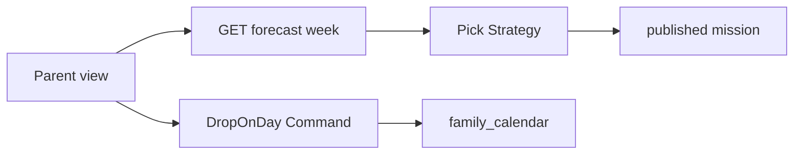

# TDD — Weekly suggestion

## Header & Metadata

| Field | Value |
|-------|-------|
| Tech lead | Bruno |
| Team | Great Kids |
| Epic | prototype high-fidelity |
| Status | Draft |
| Date | 2026-10-19 |
| Size | Small |

## Technical Solution

A short finite list of **published** missions for the week (INV-001, INV-005). Parent drops one onto a chosen calendar day in a single action. Empty published set → empty state, no invented copy. Tap without a day does not silently pick a day. MVC, unidirectional: View → Route Handler → Service → Model. Calendar write uses the suggestions envelope (INV-004).

**GoF (both, required):**
- **Strategy** — interchangeable pick algorithms (profile/ages/history/context) behind one “finite published list” rule; swapping rankers does not invent missions.
- **Command** — DropOnDay encapsulates “place this published id on this day”; invoker is the tap, receiver is the calendar day composite.

**Data flow:** 1) GET week runs pick Strategy over published+active+not deleted. 2) Response is a finite envelope, never an infinite feed. 3) Parent chooses a day, then DropOnDay. 4) Command refuses missing day and unpublished ids. 5) Calendar row gets a `scheduled` suggestion.

**API**

| Method | Resource | Request | Response |
|--------|----------|---------|----------|
| GET | `/api/families/{id}/forecast/week` | — | `{ "id", "suggestions": [{ "mission_id", "title" }] }` finite; `{ "id", "suggestions": [] }` if none |
| POST | `/api/families/{id}/forecast/week` | `{ "day", "mission_id" }` | calendar day document with scheduled suggestion; 422 if no day or unpublished |

**Persistence:** no week table. Reads `mission` (published) and profile/history/context; writes `family_calendar.suggestions`. Migration: none beyond calendar.

## Context Pillars

### Descrição
> "Uma sugestão curta e finita, que o usuário joga no calendário com um toque."

### Problema
An infinite feed competes for attention. The family needs a short, finite edit.

### Solução e trade-offs
One short published suggestion that taps onto the calendar. Trade-off: finite list vs infinite scroll (Idea Book Family Forecast).

### Exemplo / contexto
Idea Book FAMILY FORECAST. `great-kids-funcionalidades.md` Sugestão semanal.

## Context

Idea Book Family Forecast is a short edit, not a stream. Pick rules already constrain choice to approved catalog rows. The calendar day is the only legal landing place.

Stakeholders: Parent (one tap), Operator (catalog must be published), pick-rules owners.

## Problem Statement & Motivation

An infinite list trains shopping, not a family week, so the commissioner cannot tell forecast from a content dump. Invented copy when the catalog is empty violates INV-001.

If skipped, Parents stall on surprise-only, and calendar stays empty. Why now: calendar exists as the drop target.

## Scope

### In Scope (V1)
- Finite published week list as JSON envelope
- One-action drop onto an explicit day
- Empty published set → empty state, no invented title/description

### Out of Scope (V1)
- Infinite scroll / “load more”
- Silent default day
- Generated missions (non-catalog text)

### Future (V2+)
- Multi-item ranked slate with explicit caps
- Weather-tagged week using forecast contexts
- Parent skip/replace of a single slot

## Risks

| Risk | Impact | Probability | Mitigation |
|------|--------|-------------|------------|
| Empty catalog fabricated | H | M | Empty envelope; no copy invention |
| Drop without day | M | H | 422; Command requires `day` |
| Draft id in week list | H | L | Strategy reads published only |

## Implementation Plan

Each phase starts Red (failing Vitest) then Green (minimal pass), then refactor.

| Phase | Task | TDD cycle | Owner | Estimate |
|-------|------|-----------|-------|----------|
| 1 | GET week Strategy published-only | Red: draft in list → Green: published ids | Great Kids | 0.5d |
| 2 | Finite empty envelope | Red: invented row → Green: empty list | Great Kids | 0.25d |
| 3 | DropOnDay Command | Red: no day still writes → Green: 422 / scheduled | Great Kids | 0.5d |

## Testing Strategy

| Type | Scope | Approach |
|------|-------|----------|
| Unit (Vitest) | Strategy | Published-only; finite length |
| Integration (Vitest) | GET + POST drop | Envelope; calendar write; missing day |
| Contract | JSON | `{ id, suggestions: [] }` |

Critical: suggestion ids published; one tap writes calendar; list is finite.
