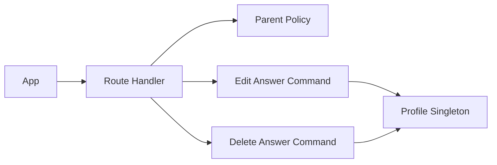

# TDD: What we know about you

## 1. Header & Metadata

| Field | Value |
|-------|-------|
| Tech lead | Bruno |
| Team | Great Kids |
| Epic | prototype high-fidelity |
| Status | Draft |
| Date | 2026-10-19 |
| Size | Small |

## 2. Technical Solution

Parent sees stored quiz answers (and notes) with source `question_id`, then edits or soft-deletes an answer. No second inferred graph. Delete sets `deleted` on that answer; it does not remove the question bank. Pick rules skip deleted answers. Envelope stays `{ id, answers: [...] }`. No ORM. Family APIs never invent missions (INV-001).

**Patterns (all required):** Command for edit and for delete. Policy: Parent of the family only; Child cannot wipe GPS; staff bank stays untouched.

**Wave 0 owns DDL.** This feature adds no tables; it mutates `family_profile.quiz_answer`.

**Schema:** each shown item `{ question_id, answer_text, deleted }`. Edit empty text reject. Delete → `deleted: true`. Bank `family_quiz` rows unchanged.

| Method | Path | Auth | Request | Response |
|--------|------|------|---------|----------|
| GET | /api/families/{id}/profile/answers | Parent of family | — | `{ id, answers: [{ question_id, answer_text, deleted }] }` |
| PATCH | /api/families/{id}/profile/answers | Parent of family | `{ question_id, answer_text }` | `{ id, answers: [{ question_id, answer_text, deleted }] }` |
| DELETE | /api/families/{id}/profile/answers | Parent of family | `{ question_id }` | `{ id, answers: [{ question_id, answer_text, deleted: true }] }` |

GET omits or marks deleted per product: hide deleted from the family list. Pick skips deleted.

## 3. Context Pillars

**How do you describe the feature?**
"Tela em que o usuário vê o que a IA anotou sobre a família. Sugestão: mostrar de qual resposta veio cada informação e permitir editar ou apagar."

**What problem does it objectively solve?**
Hidden inference feels like surveillance. The family must see, edit, or delete what was stored.

**What is the expected solution? What trade-offs does it involve?**
Read quiz_answer + profile notes with source question_id; allow edit/delete (`deleted` on answer). Trade-off: show stored answers, not a second inferred graph, until a real extractor exists.

**What example or context do we have of the problem and the solution?**
`great-kids-funcionalidades.md` O que sabemos sobre vocês.

## 4. Context

Transparency is required for playful PII. The prototype has no extractor: “what we know” is the stored envelope plus source question_id.

Staff questions remain in the bank. Families correct or hide their own answers.

## 5. Problem Statement & Motivation

Hidden stored facts feel like surveillance and fail LGPD access/erasure. Delete that drops a bank row breaks other families. Empty edit would blank GPS. Pick that still uses deleted answers ignores the family’s erasure. Cost of delay: quiz write has no correction path.

## 6. Scope

**In scope (V1):** GET answers with question_id; PATCH text; DELETE sets deleted; pick skips deleted; bank untouched.

**Out of scope:** inferred knowledge graph; hard-delete of bank questions; inventing facts or missions.

**Future:** extractor-sourced notes with provenance; export; hard purge.

## 7. Risks

| Risk | Impact | Probability | Mitigation |
|------|--------|-------------|------------|
| Delete removes bank question | H | M | Command only sets answer.deleted |
| Pick uses deleted answers | H | M | Pick skips deleted |
| Empty edit persisted | M | M | Reject empty text |

## 8. Implementation Plan

Each phase is Red (failing Vitest) then Green (minimal code), then refactor.

| Phase | Task | TDD cycle | Owner | Estimate |
|-------|------|-----------|-------|----------|
| 1 – Read | GET answers | Red: item without question_id → Green: list with source | Scultore | 0.5d |
| 2 – Commands | PATCH/DELETE | Red: delete drops bank → Green: Commands + Policy | Scultore | 0.5d |
| 3 – Pick skip | Deleted answers | Red: pick reads deleted → Green: skip flag | Scultore | 0.25d |

## 9. Security Considerations

Parent of the family only. Answers are PII. TLS in deploy; at-rest TBD. Soft-delete for erasure (LGPD access + correction + deletion). Do not log answer_text. Validate question_id ownership on that profile. Child cannot mass-delete GPS. No secrets in logs. Rate limit TBD. Unpublished missions remain panel-only on catalog APIs (INV-001, INV-005).

## 10. Testing Strategy

| Type | Scope | Approach |
|------|-------|----------|
| Unit | Edit/Delete Commands, Policy | Vitest: empty reject; bank intact; Parent only |
| Integration | GET/PATCH/DELETE | Vitest: each item has question_id; deleted true; pick skips |

Critical: each shown item has question_id; delete sets deleted true; pick rules skip deleted answers.
